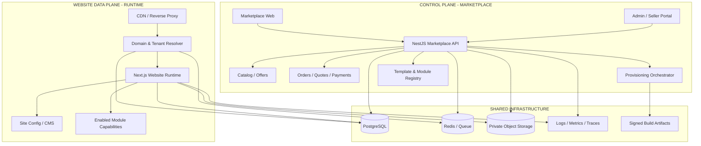
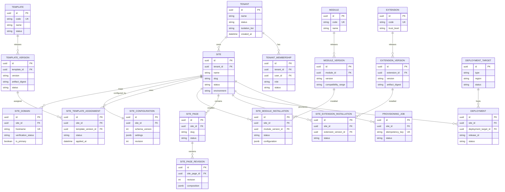
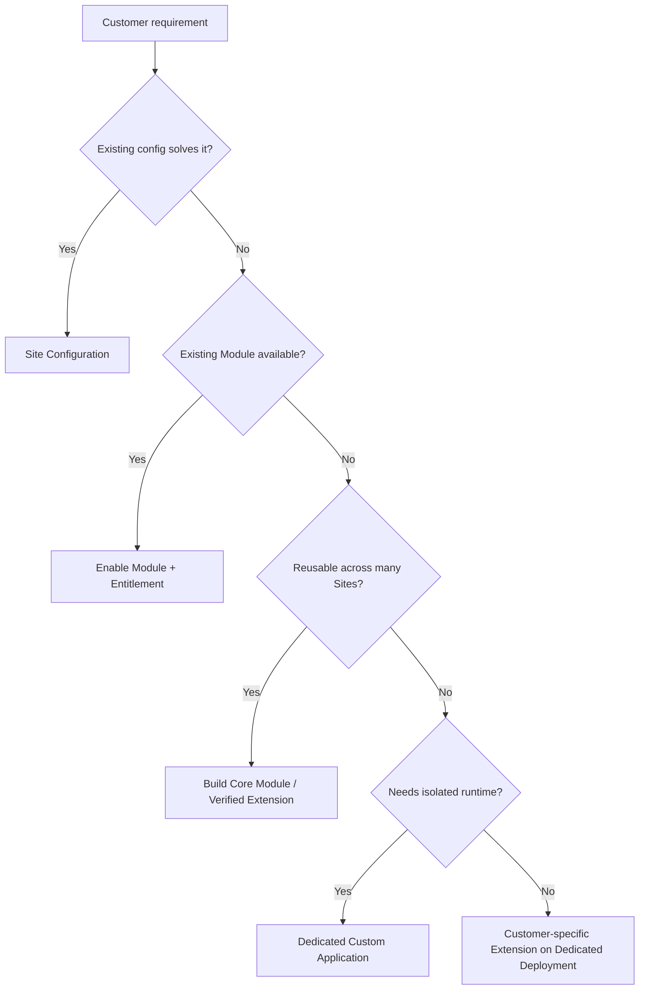
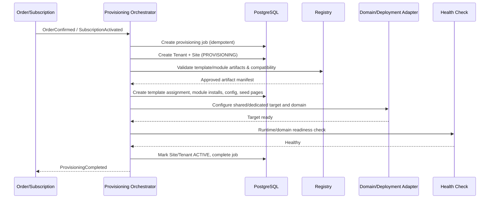

# Multi-Tenant & Template Platform Architecture

**Tài liệu:** Kiến trúc nền tảng website dùng chung source code  
**Phiên bản:** 1.0-draft  
**Ngày:** 22/11/2026  
**Trạng thái:** Proposed baseline — cần review trước khi implementation  
**Liên quan:** `PRD.md`, `TECHNICAL_SPEC.md`, `DATA_MODEL.md`, `API_SPEC.md`, `BACKLOG.md`, `DECISIONS.md`

---

## 1. Mục tiêu và phạm vi

Tài liệu này mô tả cách xây dựng một nền tảng có **một codebase được quản lý tập trung**, nhưng có thể tạo và vận hành nhiều website độc lập về domain, giao diện, nội dung, module, cấu hình và phương thức triển khai.

Nền tảng phải hỗ trợ ba loại sản phẩm thương mại:

1. **Template:** giao diện/page composition và tài nguyên thiết kế có version, có thể cấp license hoặc xuất source package.
2. **Website Package:** một offer kết hợp template, module, cấu hình khởi tạo và dịch vụ triển khai/hosting/support.
3. **Custom Development:** dự án riêng, ưu tiên tái sử dụng Core/Module; phần đặc thù được đóng gói thành extension hoặc ứng dụng độc lập tích hợp qua API/SDK.

### 1.1 Các mục tiêu kỹ thuật

- Một codebase Core/Runtime được bảo trì tập trung; không fork code tùy tiện cho từng khách hàng.
- Một Tenant có thể sở hữu nhiều Site; mỗi Site có domain, template version, module, theme và nội dung riêng.
- Tenant isolation mặc định fail-closed; không truy cập chéo dữ liệu giữa khách hàng.
- Thay đổi template/module có version, compatibility, preview, migration và rollback plan.
- Hỗ trợ Shared SaaS, Dedicated Deployment và Source Code Delivery.
- Cho phép custom behavior nhưng không cho phép chạy mã tùy ý do seller/customer upload vào runtime chung.
- Giữ kiến trúc Modular Monolith ở giai đoạn đầu; chỉ tách service khi có bằng chứng về scale, isolation hoặc ownership.

### 1.2 Không thuộc phạm vi MVP

- Theme builder kéo-thả hoàn chỉnh như một CMS thương mại.
- Seller tự upload và thực thi plugin code không qua review.
- Tự động cập nhật hàng loạt template/module cho tất cả Site.
- Tự động hóa toàn bộ hạ tầng dedicated cho mọi cloud provider.
- Tách microservice theo từng domain ngay từ ngày đầu.

---

## 2. Ngôn ngữ domain — không trộn các khái niệm

| Khái niệm | Ý nghĩa | Ví dụ |
|---|---|---|
| Marketplace Listing | Trang giới thiệu giải pháp trong marketplace | Restaurant Pro Website |
| Offer | Lựa chọn thương mại có thể mua/đặt/thuê | Source License, Managed Setup, SaaS Monthly |
| Template | Bộ định nghĩa giao diện và page composition có version | restaurant-pro@1.2.0 |
| Module | Năng lực nghiệp vụ tái sử dụng, có contract/API | CMS, Booking, Product Catalog |
| Extension | Phần mở rộng có code riêng, được kiểm duyệt và version | Real Estate Contract Workflow |
| Tenant | Tổ chức/customer workspace sở hữu dữ liệu runtime | Công ty Nhà hàng ABC |
| Site | Một website cụ thể thuộc Tenant | abc-restaurant.vn |
| Domain | Hostname được xác minh và ánh xạ tới một Site | www.abc-restaurant.vn |
| Deployment | Một lần cài đặt/phát hành runtime cho shared hoặc dedicated target | prod-release-2026.11.22 |
| Site Configuration | Cấu hình runtime của một Site | branding, locale, nav, SEO |
| Site Content | Nội dung do khách hàng quản lý | page, section, article, media |

**Quan hệ cần giữ:** Listing != Template; Offer != Package implementation; Tenant != Seller Organization; Tenant != Site; Module != Template; Extension != nội dung JSON.

Một Listing có thể cung cấp nhiều Offer. Offer có thể tham chiếu Template/Module/Extension/fulfillment options thông qua một immutable `product_configuration_snapshot`. Khi order được xác nhận, không được để thay đổi listing hoặc template mới làm thay đổi quyền lợi của order cũ.

---

## 3. Kiến trúc đích: Control Plane và Website Runtime

Tách về mặt trách nhiệm logic thành hai plane. Ban đầu chúng có thể chạy chung monorepo và một backend modular monolith, nhưng không được trộn domain model.



### 3.1 Control Plane chịu trách nhiệm

- Marketplace Listing, Offer, seller governance và license.
- Customer/Seller/Platform user và organization membership.
- Order, payment, quotation, subscription, entitlement.
- Provisioning request và orchestration.
- Template/Module/Extension registry và release metadata.
- Quản lý domain, deployment target, release status và audit.

### 3.2 Website Runtime chịu trách nhiệm

- Nhận HTTP request theo hostname.
- Xác định Domain → Site → Tenant.
- Nạp Site configuration và đúng Template Version.
- Nạp nội dung và các module đã enable, có entitlement hợp lệ.
- Render page theo schema/registered component.
- Áp dụng cache key và data scope theo tenant/site.

### 3.3 Ranh giới triển khai ban đầu

MVP có thể dùng một NestJS API và một Next.js Runtime deployment chạy nhiều Site (shared runtime). Provisioning chỉ tạo metadata/config và domain mapping; chưa cần tạo hạ tầng riêng cho mỗi Site.

Marketplace frontend/admin và Website Runtime có thể là hai Next.js app riêng trong monorepo để giảm coupling release và tối ưu cache/SEO. Nếu đội nhỏ, có thể bắt đầu bằng một Next.js app với route groups nhưng cần giữ packages và runtime boundaries rõ.

---

## 4. Mô hình domain và quan hệ dữ liệu

### 4.1 ERD logical — Runtime Platform



### 4.2 Entity definitions and constraints

#### `tenants`

- Đại diện customer workspace/runtime owner, không phải seller.
- Trường chính: `id`, `name`, `slug`, `status`, `isolation_tier` (`SHARED`, `DEDICATED_SCHEMA`, `DEDICATED_DATABASE`), `created_at`, `updated_at`, `suspended_at`.
- Status gợi ý: `PROVISIONING`, `ACTIVE`, `GRACE`, `SUSPENDED`, `CANCELLED`, `ARCHIVED`.
- Tenant không được `ACTIVE` trước khi provisioning health check thành công.

#### `tenant_memberships`

- Liên kết `user_id` với `tenant_id`, role và trạng thái membership.
- Unique `(tenant_id, user_id)`.
- Không dùng `seller_organization_id` để scope website data.

#### `sites`

- Website cụ thể thuộc một Tenant.
- Fields: `id`, `tenant_id`, `name`, `slug`, `status`, `default_locale`, `timezone`, `created_at`, `updated_at`, `archived_at`.
- Site status: `DRAFT`, `PROVISIONING`, `ACTIVE`, `SUSPENDED`, `ARCHIVED`.
- FK tenant phải được kiểm tra ở service layer và RLS.

#### `site_domains`

- Fields: `id`, `site_id`, `hostname_normalized`, `domain_type` (`PLATFORM_SUBDOMAIN`, `CUSTOM_DOMAIN`), `verification_status`, `is_primary`, `verified_at`, timestamps.
- Unique hostname toàn cục sau normalize (lowercase, IDNA/punycode và bỏ trailing dot).
- Domain phải verified trước khi nhận traffic public hoặc phát hành SSL.
- Một Site chỉ có một primary domain tại một thời điểm; có thể có nhiều alias domain.

#### `templates` / `template_versions`

- Template catalog và immutable release.
- Template Version fields: `template_id`, `version`, `artifact_digest`, `artifact_uri`, `manifest_json`, `config_schema_json`, `block_schema_json`, `runtime_api_version`, `status`, `released_at`.
- Unique `(template_id, version)`; artifact digest immutable.
- Không sửa artifact đã release. Phát hành version mới.
- Template manifest khai báo block types, compatible runtime version, supported modules, required modules và migrations.

#### `site_template_assignments`

- Lưu template version hiện tại và lịch sử áp dụng.
- Có thể dùng `is_current` hoặc `status=ACTIVE/INACTIVE`; unique partial index đảm bảo mỗi Site chỉ có một assignment hiện hành.
- Khi upgrade, lưu previous version, migration result, actor, thời gian và rollback reference.

#### `modules` / `module_versions`

- Module là năng lực nghiệp vụ (ví dụ booking, products, CMS), không chỉ là giao diện.
- Module Version fields: `module_id`, `version`, `artifact_digest`, `runtime_api_version`, `dependencies_json`, `conflicts_json`, `permissions_json`, `config_schema_json`, `status`.
- Module capability chỉ được enable nếu Site có entitlement và version tương thích với Runtime/Template.
- Tắt module phải định nghĩa xử lý dữ liệu: retain, read-only, export hoặc delete theo policy; không tự xóa dữ liệu khi disable.

#### `site_module_installations`

- Fields: `site_id`, `module_version_id`, `status`, `configuration`, `installed_at`, `disabled_at`.
- Unique `(site_id, module_version_id)` hoặc unique `(site_id, module_id)` nếu chỉ cho phép một version active.
- Module runtime phải được compile/ship cùng platform artifact hoặc load qua registry code đã được phê duyệt; không `eval` code từ DB.

#### `site_configuration`

- Lưu settings có schema: branding, logos, typography tokens, navigation, SEO defaults, locale, custom CSS policy, feature preferences.
- `schema_version` bắt buộc; thay đổi schema phải có migration.
- Không lưu business secrets hoặc private API credentials dạng plaintext. Dùng secret manager/secret references.

#### `site_pages` / `site_page_revisions`

- Page có slug/status; mỗi lần publish tạo revision bất biến.
- `composition` chỉ chứa block type đã đăng ký và props được validate bằng JSON schema.
- Unique `(site_id, locale, slug)`.
- Không lưu JSX/HTML/JS tùy ý để thực thi trong render pipeline.

#### `extensions` / `extension_versions` / `site_extension_installations`

- Extension dành cho behavior tùy chỉnh đã review.
- Manifest khai báo permissions, APIs, dependencies, compatibility, migrations và trust tier.
- Extension có thể là package build-time trong monorepo hoặc service riêng gọi qua API; không chạy arbitrary seller code trong process runtime chung.
- Có sandbox/isolation cho extension không đủ tin cậy; ưu tiên không hỗ trợ third-party executable extension ở MVP.

#### `deployment_targets` / `deployments`

- Target đại diện shared runtime, dedicated cluster/project hoặc customer-controlled destination.
- Deployment lưu immutable release ID/image digest, env, target, status, health check và rollback metadata.
- Không lưu secrets trực tiếp trong bảng deployment; chỉ tham chiếu secret manager.

#### `provisioning_jobs`

- Idempotent job tạo Tenant/Site/domain/template assignment/module installation/initial content.
- Fields: `id`, `tenant_id`, `site_id`, `job_type`, `idempotency_key`, `status`, `attempt_count`, `input_snapshot`, `result_summary`, `last_error_code`, `started_at`, `completed_at`.
- Unique idempotency key theo operation scope.

### 4.3 Scope dữ liệu: Tenant hay Site?

| Loại dữ liệu | Bắt buộc scope | Ghi chú |
|---|---|---|
| Customer users/memberships | Tenant | Thành viên có thể truy cập nhiều Site trong Tenant theo permission |
| Site config, domain, pages | Tenant + Site | FK site phải thuộc đúng tenant |
| CMS content, menus, products | Tenant + Site | Nếu module là site-specific |
| Shared contacts/CRM | Tenant; Site nullable nếu cross-site | Chỉ tạo shared entity khi có use case cụ thể |
| Orders/subscriptions marketplace | Marketplace/customer org | Không nhét nhầm vào tenant runtime |
| Listing/Seller data | Marketplace organization | Không scope theo runtime tenant |
| Audit log | Tenant và actor context nếu phát sinh trong Site | Platform audit dùng platform scope riêng |
| Media | Tenant + Site/owner + visibility | Storage key không được đoán theo URL công khai |

Nếu một bảng có `site_id`, cần bảo đảm Site thuộc đúng `tenant_id`; nên dùng composite FK `(tenant_id, site_id)` trỏ tới unique `(tenant_id, id)` trong `sites` để ngăn gắn Site của Tenant A vào record Tenant B.

---

## 5. Template Engine và Page Composition

### 5.1 Phân lớp trách nhiệm

- **Template:** bố cục trang, design tokens mặc định, block composition, assets và UX conventions.
- **Theme:** màu sắc, typography, spacing, border, component variants.
- **Page Builder Schema:** dữ liệu mô tả section/block trên trang.
- **Module:** business capability và data/API (booking, product, payment, search...).
- **Site Content:** nội dung riêng của khách hàng.

Template không được sở hữu dữ liệu nghiệp vụ. Ví dụ template restaurant có thể render menu, nhưng dữ liệu menu thuộc module Menu/Restaurant Catalog.

### 5.2 Manifest mẫu

```json
{
  "schemaVersion": 1,
  "code": "restaurant-pro",
  "version": "1.2.0",
  "runtimeApi": "^1.0.0",
  "category": "food-and-beverage",
  "supportedLocales": ["vi", "en"],
  "blocks": [
    { "type": "hero", "schema": "hero.v1" },
    { "type": "menu-preview", "requiresModule": "menu" },
    { "type": "booking-cta", "requiresModule": "booking" }
  ],
  "requiredModules": ["cms"],
  "optionalModules": ["menu", "booking", "contact"],
  "configSchema": "./schemas/site-config.schema.json"
}
```

### 5.3 Page composition mẫu

```json
{
  "schemaVersion": 1,
  "templateVersion": "1.2.0",
  "page": {
    "slug": "/",
    "locale": "vi",
    "sections": [
      {
        "id": "hero-main",
        "type": "hero",
        "version": 1,
        "props": {
          "title": "Nhà hàng của chúng tôi",
          "imageAssetId": "asset-uuid"
        }
      },
      {
        "id": "menu-home",
        "type": "menu-preview",
        "version": 1,
        "props": { "limit": 6 }
      }
    ]
  }
}
```

### 5.4 Block Registry

Runtime ánh xạ block type tới component code đã được đóng gói:

```ts
export interface PageBlockDefinition<TProps = unknown> {
  type: string;
  version: number;
  validate(props: unknown): TProps;
  component: React.ComponentType<{ props: TProps; site: SiteRuntimeContext }>;
}

export const blockRegistry = {
  hero: HeroBlockDefinition,
  'menu-preview': MenuPreviewBlockDefinition,
  'booking-cta': BookingCtaBlockDefinition,
} satisfies Record<string, PageBlockDefinition>;
```

Quy tắc:

- Validate schema ở write/publish time và runtime defense-in-depth.
- Unknown block type phải fail safe: ẩn block và log structured error, không execute payload.
- Block cần module thì kiểm tra module đã active và entitlement hợp lệ.
- HTML rich text phải sanitize theo allowlist; tránh raw HTML/JS injection.
- Custom CSS phải sandbox theo policy, CSP và không cho truy cập dữ liệu runtime.

### 5.5 Template release và pinning

- Mỗi Site pin một Template Version cụ thể.
- Template Version đã publish là immutable.
- Release mới không tự động thay đổi Site hiện hữu.
- Upgrade có preview, compatibility validation, content/config migration và rollback point.
- Breaking change tăng major; compatible feature/minor changes theo semantic versioning.
- Có thể dùng canary rollout trên một nhóm Site trước khi rollout rộng.

---

## 6. Module và Extension Architecture

### 6.1 Module contract

Module là capability có interface rõ ràng, ví dụ `booking`, `catalog`, `payment`, `analytics`. Module cần khai báo:

- Code/name/version.
- Runtime API compatibility.
- Required dependencies và conflicts.
- Permissions/scopes.
- Configuration schema.
- Data migrations và downgrade/rollback strategy.
- Public API/events.
- Entitlement requirements.

### 6.2 Lifecycle

`AVAILABLE → INSTALLING → ACTIVE → DISABLING → DISABLED` (có thể có `FAILED`).

Install phải idempotent. Không xóa dữ liệu chỉ vì module bị disable. Uninstall chỉ được phép khi đã kiểm tra dependency, dữ liệu cần export/retention và có xác nhận quyền phù hợp.

### 6.3 Extension policy

Phân loại:

1. **First-party extension:** code do platform team kiểm soát; có thể build cùng monorepo.
2. **Verified partner extension:** review source, security scan, signed artifact, permission manifest và compatibility certification.
3. **Customer-specific extension:** phát triển theo dự án, build riêng và triển khai vào dedicated target hoặc qua isolated service.

Không hỗ trợ extension code chưa xác minh chạy trong shared runtime. Không tải file JS/TS từ database hoặc seller upload rồi `eval/import` trong request runtime.

### 6.4 Custom Development decision tree



---

## 7. Tenant Resolution và Request Lifecycle

### 7.1 Request flow

1. CDN/reverse proxy nhận request và truyền hostname qua trusted proxy configuration.
2. Runtime normalize hostname (lowercase, IDNA) và lookup domain map.
3. Chỉ chấp nhận domain đang `VERIFIED` và Site/Tenant đang active.
4. Resolve `site_id`, `tenant_id`, deployment/environment và cache key.
5. Load Site runtime snapshot: template version, theme/config revision, active modules, published page revision.
6. Tạo immutable `SiteRuntimeContext` cho request.
7. Các repository/data services dùng context đó và không nhận tenant ID tùy ý từ client.
8. Render response; cache theo host/site + version/revision + locale.

### 7.2 Context contract

```ts
export interface SiteRuntimeContext {
  tenantId: string;
  siteId: string;
  hostname: string;
  environment: 'PREVIEW' | 'PRODUCTION';
  template: { code: string; version: string; artifactDigest: string };
  configRevision: number;
  locale: string;
  enabledModules: ReadonlySet<string>;
  requestId: string;
}
```

Context phải được tạo từ resolver phía server. Không serialize internal secrets hoặc raw permission claims không cần thiết xuống browser.

### 7.3 Domain lookup/cache

- Cache hostname → site mapping với TTL ngắn và invalidation khi domain/site state thay đổi.
- Cache key: `domain-map:{normalized-host}`.
- Runtime config cache key: `site-runtime:{siteId}:{configRevision}:{templateVersion}:{locale}`.
- Purge cache theo Site khi publish content/config hoặc thay domain.
- Không cache response riêng tư (admin/customer/session) trong public shared cache.
- Với custom domain, xác minh DNS TXT/CNAME và trạng thái SSL trước khi active.

### 7.4 Fail-closed behavior

- Domain không tồn tại/chưa verify: trả 404 hoặc trang hướng dẫn domain, không fallback sang tenant mặc định.
- Tenant/Site suspended: trả trang trạng thái phù hợp, không phục vụ content private.
- Context thiếu: từ chối truy vấn tenant-scoped.
- Module inactive/entitlement hết hạn: disable capability theo policy; không chỉ ẩn UI mà bỏ kiểm tra backend.

---

## 8. Tenant Isolation và Security Design

### 8.1 Khuyến nghị isolation theo phase

| Tier | Mô hình | Đối tượng | Ghi chú |
|---|---|---|---|
| Shared | Một PostgreSQL DB, shared schema, `tenant_id` + `site_id` | SaaS standard | Mặc định MVP; chi phí thấp |
| Dedicated Schema | Schema riêng trong một DB | Khách hàng cần isolation cao hơn | Cần quản lý migration nhiều schema |
| Dedicated Database | DB riêng, credential riêng | Enterprise/regulated workloads | Backup/restore và vận hành độc lập |
| Customer-managed | Hạ tầng do khách hàng kiểm soát | Source delivery/custom enterprise | Phải xác định support boundary |

Bắt đầu bằng Shared model; thiết kế provisioning abstraction để sau này tạo Dedicated target mà không đổi nghiệp vụ Site/Template.

### 8.2 Shared DB mandatory controls

- Bảng runtime tenant-owned phải có `tenant_id`; bảng site-owned có cả `tenant_id`, `site_id`.
- Composite FK hoặc service invariant bảo đảm `site_id` thuộc `tenant_id` tương ứng.
- PostgreSQL RLS là defense-in-depth; transaction phải set tenant context an toàn (`SET LOCAL`) theo connection/transaction, không dùng session setting rò qua connection pool.
- Mọi repository tenant-scoped yêu cầu `TenantContext`/`SiteRuntimeContext`; thiếu context throw error.
- RLS policy phải fail closed nếu context null.
- Cross-tenant integration tests phải chạy trên PostgreSQL thật, không chỉ mock repository.
- Background jobs phải mang tenant/site scope trong payload đã ký/được tạo nội bộ và xác thực lại trước xử lý.

### 8.3 Authorization

- RBAC + resource-level policy; membership role không thay thế kiểm tra resource ownership.
- Platform support access cần permission riêng, reason code, thời hạn và audit log.
- Seller organization không mặc định có quyền truy cập Tenant runtime; quyền truy cập dự án chỉ thông qua explicit grant/contract.
- ID public không được xem là bí mật; luôn kiểm tra ownership/entitlement.

### 8.4 File isolation

Object key nên theo dạng opaque namespace, không suy ra từ tên tenant/domain:

`tenants/{tenantId}/sites/{siteId}/{assetId}`

- Private bucket mặc định; public asset được publish qua CDN policy.
- Signed URL ngắn hạn, kiểm tra entitlement/ownership trước khi cấp.
- Scan MIME thực, file signature, antivirus/quarantine, max file size và extension allowlist.
- Source package không nằm chung public media bucket.

### 8.5 Secrets và supply chain

- Secrets chỉ trong secret manager/environment secret, không trong `site_configuration` hoặc template manifest.
- Template/module artifacts phải được build, scan và ký; runtime chỉ chấp nhận digest được registry tin cậy.
- Dependency scan, SBOM, license review và vulnerability scanning trước release.
- Không cho seller truyền arbitrary npm dependency vào shared runtime.

---

## 9. Deployment Modes

### 9.1 Mode A — Shared SaaS Runtime

Một Next.js Runtime deployment phục vụ nhiều Site theo hostname. Các Site dùng chung application image và runtime infrastructure, nhưng dữ liệu/config/domain tách biệt bằng tenant/site context.

**Phù hợp:** gói subscription, khách hàng vừa và nhỏ, quản lý tập trung.

**Ưu điểm:** chi phí thấp, nâng cấp platform tập trung, provisioning nhanh.  
**Rủi ro:** isolation/caching phải chính xác; noisy neighbor; custom code không được thực thi tùy ý.

### 9.2 Mode B — Dedicated Deployment

Mỗi tenant/khách enterprise có runtime deployment riêng, có thể DB/schema riêng. Artifact/image vẫn được build từ cùng source code và cùng release pipeline.

**Phù hợp:** Enterprise, SLA riêng, custom extension, yêu cầu cách ly.

- Pin image digest và template/module versions.
- Secrets/config riêng.
- Migration/health check có kiểm soát.
- Có rollback deployment và DB migration strategy.
- Chi phí hạ tầng, backup, monitoring và upgrade cao hơn.

### 9.3 Mode C — Source Code Delivery

Không export toàn bộ Marketplace monorepo. Tạo customer delivery bundle từ allowlisted packages:

- Core runtime SDK hoặc licensed runtime source.
- Template/version được mua.
- Modules được entitlement cho phép.
- Customer-specific extension (nếu hợp đồng bao gồm).
- Configuration seed, migrations, setup/deployment docs.
- SBOM, license notices, version manifest và checksum.

Delivery phải được sinh từ reproducible build; tải xuống bằng entitlement có thời hạn; log download và thu hồi quyền cho lần tải mới nếu license/hợp đồng cho phép. Không thể thu hồi source code đã tải về, vì vậy license/hợp đồng phải nói rõ quyền sử dụng.

### 9.4 So sánh deployment

| Tiêu chí | Shared SaaS | Dedicated | Source Delivery |
|---|---|---|---|
| Source runtime | Platform-owned shared | Same code/image | Bundle theo license |
| Hosting | Platform | Platform hoặc khách hàng | Khách hàng/đối tác |
| Tenant isolation | Logical + RLS | Infra/DB isolation tùy cấu hình | Theo hạ tầng khách hàng |
| Update | Central release/canary | Per-target rollout | Customer-controlled |
| Custom code | Chỉ code được duyệt | Có thể extension riêng | Theo license/bundle |
| Billing | Subscription | Setup + recurring support/hosting | One-time/license/maintenance |

---

## 10. Provisioning Workflow

> **Phân ranh với marketplace backlog:** `WM-090/WM-091` quản lý subscription lifecycle và business trigger tạo tenant; `MT-060` quản lý kỹ thuật provision Tenant/Site/runtime resources sau khi nhận event. Chỉ một Provisioning Orchestrator được sở hữu state machine runtime để tránh hai luồng tạo tenant trùng nhau.

### 10.1 Input

Provisioning được kích hoạt từ event `OrderConfirmed`, `SubscriptionActivated` hoặc admin-approved project milestone. Input gồm:

- `order_id` / `order_item_id` / `subscription_id`.
- Customer organization và tenant owner.
- `site_name`, desired slug/domain.
- Template version và module versions đã snapshotted.
- deployment mode/target.
- locale/timezone.
- seed content preset.
- idempotency key.

Không nhận giá, seller ID, entitlement hoặc role từ browser làm nguồn sự thật; đọc từ immutable order/entitlement trong backend.

### 10.2 Sequence



### 10.3 Job states

`QUEUED → VALIDATING → CREATING_RESOURCES → CONFIGURING → DEPLOYING → VERIFYING → COMPLETED`

Failure: `RETRY_WAIT`, `FAILED`, `CANCELLED`. Retry phải idempotent; job có attempt limit/backoff và manual retry. Không xóa một phần resource không rõ trạng thái; dùng compensating actions và cleanup job.

### 10.4 Provisioning acceptance criteria

- Event lặp không tạo duplicate Tenant/Site.
- Tenant/Site chưa `ACTIVE` trước health check thành công.
- Template/module versions đúng snapshot đã mua.
- Domain chưa verified không nhận traffic customer.
- Lỗi giữa chừng có thể retry hoặc cleanup an toàn.
- Audit log ghi actor/source order/job correlation ID.

---

## 11. Template/Module Upgrade, Migration và Rollback

### 11.1 Release policy

- Semantic versioning: major = breaking; minor = backward-compatible feature; patch = compatible fix.
- Artifact bất biến sau release; registry lưu digest.
- Manifest chỉ rõ `runtimeApi`, `configSchemaVersion`, dependencies và migrations.
- Site pin version; không tự động update.

### 11.2 Upgrade flow

1. Chọn Site hoặc rollout cohort.
2. Check compatibility: Runtime API, module dependencies, config schema và entitlements.
3. Clone/backup config/content revision cần thiết.
4. Run dry-run migration và tạo report.
5. Render preview trên staging/preview domain.
6. Admin/customer có quyền approve.
7. Apply migration theo transaction hoặc migration job có checkpoint.
8. Health check, smoke test và publish release pointer.
9. Nếu lỗi, rollback code/config pointer; data migration chỉ rollback nếu migration reversible, nếu không phải dùng forward-fix/restore plan.

### 11.3 Không giả định rollback DB luôn đơn giản

Rollback code/template không đồng nghĩa rollback dữ liệu. Mọi migration cần ghi `up`, `down` nếu reversible; migration destructive phải có backup, compatibility window và forward recovery plan. Không tự động drop cột/bảng ngay trong cùng release breaking change.

---

## 12. API Surface đề xuất

Tất cả endpoint quản trị đi qua authenticated API. Public runtime có thể sử dụng internal runtime API hoặc server-side repository/service; không expose endpoint trả toàn bộ cấu hình nhạy cảm.

### 12.1 Site / Tenant Admin API

| Method | Endpoint | Mục đích |
|---|---|---|
| POST | `/api/v1/tenants` | Tạo tenant (admin/provisioning service) |
| GET | `/api/v1/tenants/:tenantId` | Xem tenant theo quyền |
| POST | `/api/v1/tenants/:tenantId/sites` | Tạo Site draft |
| GET | `/api/v1/sites/:siteId` | Chi tiết Site |
| PATCH | `/api/v1/sites/:siteId` | Cập nhật metadata/config có validate |
| POST | `/api/v1/sites/:siteId/domains` | Thêm domain |
| POST | `/api/v1/sites/:siteId/domains/:domainId/verify` | Chạy/kiểm tra verification |
| PUT | `/api/v1/sites/:siteId/template` | Gán template version |
| POST | `/api/v1/sites/:siteId/modules` | Install/enable module version |
| DELETE | `/api/v1/sites/:siteId/modules/:installationId` | Disable module (không xóa data mặc định) |
| POST | `/api/v1/sites/:siteId/provision` | Tạo provisioning job |
| GET | `/api/v1/sites/:siteId/deployments` | Lịch sử deployment |
| POST | `/api/v1/sites/:siteId/releases` | Tạo preview/upgrade release |
| POST | `/api/v1/sites/:siteId/releases/:releaseId/approve` | Approve rollout |
| POST | `/api/v1/sites/:siteId/releases/:releaseId/rollback` | Rollback version pointer/deployment |

### 12.2 Runtime resolution API

Nếu Runtime không truy cập DB trực tiếp, internal endpoint có thể là:

- `GET /internal/runtime/resolve?hostname=...`
- `GET /internal/runtime/sites/:siteId/snapshot`

Chỉ private network/service identity được gọi. Không mở public và không nhận tenant ID do browser chỉ định. Nên ưu tiên server-side service/repository trong cùng monolith để tránh extra network hop ở MVP.

### 12.3 Template/Module Registry API

- `GET /api/v1/registry/templates`
- `GET /api/v1/registry/templates/:code/versions`
- `POST /api/v1/admin/registry/templates/:code/releases`
- `GET /api/v1/registry/modules`
- `POST /api/v1/admin/registry/modules/:code/releases`

Registry release endpoint cần kiểm tra signed artifact, manifest schema, compatibility, security scan result và permission scope.

---

## 13. Cache, SEO và Runtime Performance

- Public catalog SEO thuộc Marketplace; website runtime SEO dùng Site-specific metadata và canonical domain.
- Resolve domain cache tách khỏi content cache.
- Cache key tối thiểu gồm `site_id`, `template_version`, `config_revision`, `page_revision`, `locale`.
- Publish page/config phải bump revision hoặc invalidation event.
- Shared runtime phải chống cache poisoning bằng host normalization và trusted host allowlist.
- Không cache HTML đã render cho user-specific content trong shared public cache.
- ISR/revalidate theo Site/page revision; tránh một Site revalidate làm purge toàn bộ platform.
- Image optimization và asset URL phải được policy theo domain/storage; private asset không public hóa qua optimizer.

---

## 14. Observability và Operations

Mọi log/trace cho website request và provisioning job nên gắn:

- `request_id` / `correlation_id`.
- `tenant_id`, `site_id` (không đưa PII vào metric label).
- `deployment_id` / `release_id` khi phù hợp.
- `template_code`, `template_version`.
- `module_codes` ở dạng safe metadata.

Metrics cần có:

- Domain resolve hit/miss/error latency.
- Runtime render p50/p95/p99 và HTTP error rate.
- Cross-tenant authorization failures.
- Provisioning queue lag, retry count, failure rate/time-to-ready.
- Template/module upgrade success/failure/rollback.
- Cache hit ratio theo runtime dimension.
- Tenant/site active/suspended count.

Alert các tình huống: domain mapping sai, tenant context missing, spike 403/404, provisioning stuck, failed migration, artifact digest mismatch và queue dead-letter.

---

## 15. Testing Strategy và Definition of Done

### 15.1 Unit

- Hostname normalize.
- Domain resolver state rules.
- Template/module compatibility.
- Manifest schema validation.
- Config/page block validation.
- Provisioning state machine.
- Entitlement checks.

### 15.2 Integration (PostgreSQL thật)

- RLS tenant isolation: Tenant A không đọc/sửa/xóa Tenant B.
- Composite FK: không gán Site khác Tenant.
- Domain unique and verification.
- Template assignment unique current version.
- Module dependencies/conflicts.
- Idempotent provisioning event.
- Migration/rollback contract.

### 15.3 E2E

1. Tạo order SaaS → provisioning → site active → domain resolve → render template đúng.
2. Tenant A và B truy cập hai domain cùng runtime, nhận đúng content và config riêng.
3. Request từ domain chưa verified không render Site.
4. Module đã disable không expose UI/API capability.
5. Upgrade template trên Site A không ảnh hưởng Site B.
6. Custom domain đổi mapping có cache invalidation.
7. Customer không thể truy cập Site của Tenant khác bằng cách sửa ID.
8. Dedicated deployment pin đúng image/template/module release.

### 15.4 Definition of Done cho MVP Runtime

- [ ] Tạo Tenant/Site bằng admin hoặc seed/provisioning service.
- [ ] Site có subdomain platform và resolve đúng.
- [ ] Một Runtime phục vụ ít nhất hai Site với template/config/content khác nhau.
- [ ] Template pin theo version và không bị update ngoài ý muốn.
- [ ] Page composition chỉ render registered blocks đã validate.
- [ ] CMS/data query tenant+site scoped.
- [ ] Cross-tenant integration tests pass trên PostgreSQL.
- [ ] Cache key/invalidation chứa site/version/revision.
- [ ] Domain/site suspend được xử lý đúng.
- [ ] Có audit log cho thay đổi template/module/domain.

---

## 16. Repository Structure đề xuất

Monorepo dùng pnpm workspace và Turborepo/Nx là lựa chọn đề xuất, không phải yêu cầu bắt buộc. Giữ package boundaries độc lập để dễ tách deployment khi cần.

```text
website-marketplace/
├── apps/
│   ├── marketplace-web/          # public catalog + customer portal
│   ├── admin-web/                # platform operations/admin
│   ├── seller-web/               # seller portal (phase sau)
│   ├── website-runtime/          # hostname-based multi-site renderer
│   ├── api/                      # NestJS modular monolith
│   └── worker/                   # queue consumers/provisioning jobs
│
├── packages/
│   ├── domain-contracts/         # shared types/events/contracts
│   ├── database/                 # schema, migrations, repositories
│   ├── auth/                     # identity/access policies
│   ├── tenant-context/           # trusted tenant/site context
│   ├── runtime-sdk/              # runtime APIs for templates/modules
│   ├── template-sdk/             # manifest/block contracts
│   ├── extension-sdk/            # reviewed extension contracts
│   ├── ui/                       # shared design system
│   ├── config-schema/            # zod/json schemas
│   └── observability/            # logger/metrics/tracing
│
├── templates/                   # first-party reviewed template packages
│   ├── restaurant-pro/
│   ├── corporate-modern/
│   └── ecommerce-starter/
│
├── modules/                     # first-party business capabilities
│   ├── cms/
│   ├── menu/
│   ├── booking/
│   ├── product-catalog/
│   └── checkout/
│
├── extensions/                  # reviewed/platform-owned extensions only
├── infra/                       # docker, deployment, scripts, monitoring
├── docs/                         # product, architecture, delivery
└── tests/                        # integration/e2e/security/load
```

**Build-time rule:** Không đưa toàn bộ template hoặc extension không cần thiết vào mọi customer source bundle. Pipeline build artifact từ allowlist packages và version lock; runtime shared có thể chứa nhiều first-party template đã duyệt, nhưng Site chỉ được gán version có trong registry.

---

## 17. Rollout Roadmap

| Phase | Phạm vi | Kết quả cần chứng minh |
|---|---|---|
| A — Foundation | Tenant/Site/domain model, site context, RLS, runtime host resolution | Hai Site khác nhau chạy trên một runtime và không lẫn dữ liệu |
| B — Template Runtime | Template manifest, version pinning, block registry, config schema | Thay template/config từng Site không tạo project mới |
| C — Modules | Module registry, install/enable, entitlement và API guard | Một capability có thể bật cho Site này, tắt ở Site khác |
| D — Provisioning | Provisioning job, seed config, domain setup, health check | Order/subscription có thể tạo Site lặp an toàn |
| E — Releases | Template/module upgrade, preview, migration, rollback | Upgrade có kiểm soát và không tác động Site chưa chọn |
| F — Dedicated | Deployment adapter, isolated DB/secret/monitoring | Một codebase tạo được shared và dedicated target |
| G — Source Delivery | Build bundle, license manifest, SBOM, signed artifact | Khách hàng nhận đúng source scope được cấp phép |
| H — Extensions | Extension SDK, review pipeline, isolated execution/deploy | Custom behavior không fork/đụng Core |

### Go/No-Go gates

- Không mở SaaS public trước khi test tenant isolation, domain verification và restore drill pass.
- Không cho phép seller publish template executable trước khi có review/signing/rollback process.
- Không tự động upgrade hàng loạt trước khi hoàn tất preview, migration và rollback workflow.
- Không mở payout hoặc source resale trước khi legal/license/tax/finance policy được phê duyệt.

---

## 18. Architecture Decision Records (ADR)

### ADR-MT-001 — Tenant và Site là hai entity riêng

**Quyết định:** Một Tenant có thể có nhiều Site. Domain ánh xạ tới Site, không ánh xạ thẳng tới Tenant.  
**Lý do:** Một customer có thể sở hữu nhiều brand/domain với template, content và module khác nhau.  
**Hệ quả:** Cần `tenant_id` và `site_id` scope rõ; không coi mỗi domain là một tenant.

### ADR-MT-002 — Shared SaaS là deployment mặc định, Dedicated là tier mở rộng

**Quyết định:** MVP dùng shared runtime/shared DB với tenant isolation; giữ adapter để chuyển dedicated.  
**Lý do:** Giảm cost/ops trước khi có nhu cầu enterprise thực tế.  
**Hệ quả:** RLS và isolation test là release gate, không phải hardening sau này.

### ADR-MT-003 — Template là versioned artifact + declarative composition

**Quyết định:** Template release immutable; page content dùng schema JSON và registered block types.  
**Lý do:** Hạn chế arbitrary code execution, dễ validate/preview/migrate.  
**Hệ quả:** Các template cực kỳ tùy biến có thể cần code package được review/build thay vì chỉ cấu hình.

### ADR-MT-004 — Module là business capability, không phải theme component

**Quyết định:** Module sở hữu API/data/business rules; template sở hữu presentation/composition.  
**Lý do:** Có thể đổi giao diện mà giữ nguyên nghiệp vụ, hoặc dùng cùng capability ở nhiều template.  
**Hệ quả:** Cần module contracts, permission, entitlement và compatibility registry.

### ADR-MT-005 — Không execute seller code trong shared runtime

**Quyết định:** Third-party executable extension phải qua review, signed artifact và isolated/dedicated execution; không eval code upload.  
**Lý do:** Giảm nguy cơ remote code execution và cross-tenant compromise.  
**Hệ quả:** Marketplace extension ecosystem chỉ mở ở phase sau.

### ADR-MT-006 — Một codebase không đồng nghĩa một deployment

**Quyết định:** Shared SaaS, Dedicated và Source Delivery đều build từ codebase/CI pipeline chung nhưng có runtime/deployment target khác nhau.  
**Lý do:** Nhu cầu SLA, isolation và ownership khác nhau.  
**Hệ quả:** Release artifact phải immutable và pin theo digest.

---

## 19. Quyết định cần Product/Engineering chốt

| # | Câu hỏi | Default đề xuất | Khi nào cần chốt |
|---|---|---|---|
| 1 | MVP có cần nhiều Site/tenant chạy thật không? | Có; tối thiểu 2–3 Site trên shared runtime | Trước R0/R1 |
| 2 | Tenant mặc định là customer organization hay cá nhân? | Organization/workspace; cá nhân được tạo workspace một thành viên | Trước auth/organization model |
| 3 | Site có dùng chung CMS content trong một Tenant không? | Không mặc định; content site-scoped | Trước schema CMS |
| 4 | Custom domain ai cấu hình DNS? | Customer cấu hình theo hướng dẫn; platform verify | Trước custom domain launch |
| 5 | Ai được phát hành template? | Platform Admin/reviewer; seller submit draft | Trước seller template upload |
| 6 | Template code seller có được execute? | Không trong shared runtime | Trước extension marketplace |
| 7 | Source delivery license ra sao? | Per-customer/per-project license; legal review | Trước source sale |
| 8 | Dedicated deployment do ai vận hành? | Platform vận hành trước; customer-managed là service tier khác | Trước enterprise offer |
| 9 | Module disable có xóa dữ liệu không? | Không; retain/read-only/export theo policy | Trước module lifecycle |
| 10 | Có cho phép một Site nhiều template/theme? | Một active template version; theme tokens/site config riêng | Trước template engine |

---

## 20. Hướng dẫn triển khai

1. Review và phê duyệt ADR-MT-001 đến ADR-MT-006.
2. Đối chiếu `DATA_MODEL.md`; tạo migration riêng cho `tenants`, `sites`, `site_domains`, `templates`, `template_versions`, `site_template_assignments`, `modules`, `module_versions`, `site_module_installations`, `site_configuration`, `site_pages`, `site_page_revisions`, `deployments`, `provisioning_jobs`.
3. Triển khai TenantContext/SiteRuntimeContext và repository scoping trước khi xây CMS/module data.
4. Làm domain resolution và hai website demo trên cùng Runtime.
5. Làm template manifest, block registry và pinned version.
6. Làm module enablement và authorization server-side.
7. Sau khi security tests pass mới làm provisioning tự động.
8. Đưa dedicated/source delivery/extensions sang phase riêng.

Không bắt đầu bằng việc xây page builder kéo-thả hoặc plugin marketplace. Hãy chứng minh trước rằng **một runtime có thể phục vụ hai Site độc lập, mỗi Site dùng template/config/module khác nhau và không thể đọc lẫn dữ liệu**.
