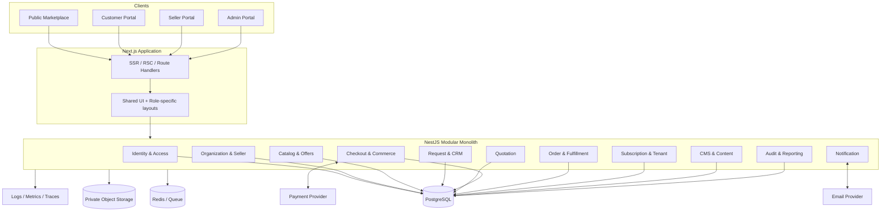

# Technical Specification — Website Marketplace

**Version:** 1.0-draft  
**Date:** 22/11/2026  
**Architecture status:** Proposed baseline

## 1. Technical Objectives

- Hỗ trợ listing từ platform và nhiều seller/partner.
- Tách listing, offer, pricing, fulfillment và order lifecycle.
- Hỗ trợ fixed-price, quote-based và recurring subscription.
- Hỗ trợ source delivery, managed project, SaaS tenant và custom project theo phase.
- Đảm bảo quyền truy cập seller/customer/tenant được kiểm soát ở backend.
- Có khả năng mở rộng mà không phải chuyển sang microservices quá sớm.

## 2. Recommended Technology Baseline

| Layer | Recommendation | Reason |
|---|---|---|
| Public web / customer portal / seller portal / admin | Next.js (TypeScript) | SSR/SEO cho catalog; một codebase có thể tổ chức route groups và layouts riêng |
| Backend API | NestJS (TypeScript) | Module boundaries, DI, validation, guards, OpenAPI |
| Primary database | PostgreSQL | Quan hệ listing/offer/order/payment/ledger; transaction, FK, unique constraint và reporting |
| ORM / migrations | Prisma hoặc TypeORM; chọn một và chuẩn hóa | Typed access/migration; không dùng song song nhiều ORM |
| Cache / queues / rate limit | Redis + BullMQ hoặc queue abstraction tương đương | Email, file scan, provisioning, webhook processing và background jobs |
| File/object storage | S3-compatible private bucket | Listing media, customer attachments, source package và handover files |
| Search | PostgreSQL full-text/trigram ở MVP; dedicated search service khi cần | Tránh vận hành Elasticsearch/OpenSearch trước khi có quy mô |
| Email | Provider adapter + transactional templates | Dễ thay nhà cung cấp, retry và delivery tracking |
| Payment | Payment adapter theo provider | Tách domain khỏi cổng thanh toán |
| Observability | Structured logs + error tracking + metrics/tracing | Trace từ request đến job/provider |
| Deployment | Docker, CI/CD, separate dev/staging/prod | Reproducible environment và rollback |

**Database recommendation:** PostgreSQL được chọn cho core marketplace vì giao dịch, báo giá, đơn hàng, payment event và financial ledger cần ràng buộc quan hệ và transaction rõ ràng. Nếu đội dự án bắt buộc dùng MongoDB, phải thiết kế lại phần reference integrity, unique indexes và transaction boundary; không nên chuyển nguyên ERD quan hệ thành document lồng nhau một cách cơ học.

Không ghim version framework trong spec này. Khi khởi tạo repository, chốt một phiên bản LTS/stable được hỗ trợ tại thời điểm triển khai, commit lockfile và kiểm tra compatibility/security advisories.

## 3. Architecture Style

### 3.1 Modular Monolith first

Dùng một NestJS application với module/domain boundaries rõ ràng, không chia microservices ngay từ đầu. Tách deployment worker process riêng khi cần, nhưng cùng codebase và cùng domain contracts.

Lợi ích:
- Transaction xuyên quotation/order/payment đơn giản hơn.
- Ít hạ tầng và chi phí vận hành.
- Dễ debug, test integration và rollback.
- Có thể tách module thành service sau này nếu có nhu cầu/scale evidence.

Ranh giới module phải được giữ bằng public service/interface, không để module truy cập trực tiếp repository nội bộ của module khác.

### 3.2 High-level component diagram



### 3.3 Suggested repository structure

```text
website-marketplace/
  apps/
    web/                         # Next.js public + customer + seller + admin
    api/                         # NestJS API
    worker/                      # Background jobs; may share API modules
  packages/
    contracts/                   # DTO schemas, generated API types
    ui/                          # Shared UI components
    config/                       # eslint, tsconfig, env schema
  infra/
    docker/
    deployment/
    scripts/
  docs/
    product/
    architecture/
    delivery/
  prisma/ or database/
    schema.prisma
    migrations/
    seed/
  tests/
    e2e/
```

A monorepo (pnpm workspaces + Turborepo/Nx) is reasonable if the team wants shared contracts. A simpler separate frontend/backend repository is also valid; choose one approach at project initialization and avoid premature tooling complexity.

## 4. Backend Domain Modules

| Module | Owns | Must not own |
|---|---|---|
| IdentityModule | users, sessions, verification, password reset | business order logic |
| AccessControlModule | roles, permissions, membership/policy checks | user profile content |
| OrganizationModule | organizations, memberships, seller profiles/applications | listing commercial terms |
| CatalogModule | categories, tags, features, listings, revisions, media references | payment and order state |
| OfferModule | offer type, price configuration, license, scope, entitlements metadata | payment capture |
| RequestModule | quote requests, answers, assignments, messages, timeline | quotation totals |
| QuotationModule | versions, line items, acceptance/rejection, expiry | payment provider details |
| CheckoutModule | checkout intent, order creation, price snapshot | SaaS tenant provisioning |
| PaymentModule | payment attempts, provider events, refund records, reconciliation | direct listing mutations |
| OrderModule | order state and fulfillment orchestration | provider-specific webhook parsing |
| DeliveryModule | source entitlements, private downloads and handover packages | subscription billing |
| ProjectModule | milestones, deliverables, acceptance and change requests | general-purpose issue tracking |
| SubscriptionModule | subscription lifecycle, plan, billing schedule | SaaS tenant data itself |
| TenantProvisioningModule | tenant/workspace lifecycle, domain and provisioning jobs | seller organization membership |
| NotificationModule | templates, queue, delivery logs, preferences | business state authority |
| CMSModule | pages, homepage sections, FAQs, legal content | catalog product records |
| ReviewModule | eligible reviews, moderation | order payment authority |
| AdminModule | admin workflows and read models | bypassing domain services |
| AuditModule | audit events, actor/context | editing source business records |

## 5. Cross-cutting Architecture Rules

### 5.1 Authentication and session

- Use server-managed session or short-lived access token with rotating refresh strategy; web browser session should use `HttpOnly`, `Secure`, appropriate `SameSite` cookies.
- Do not store long-lived bearer tokens in `localStorage`.
- Email verification required for customer account and seller application ownership.
- Password reset token must be single-use, short-lived and hashed at rest.
- Implement session listing/revocation and login rate limiting.
- OAuth/social login is optional and must map to an existing verified account safely.

### 5.2 Authorization

- RBAC is necessary but not sufficient. Use resource-level policy checks.
- Roles are assigned to organization memberships (e.g. CUSTOMER_OWNER, SELLER_OWNER, SELLER_EDITOR, SELLER_FINANCE) and platform roles (e.g. PLATFORM_ADMIN, SUPPORT, FINANCE).
- Every seller-scoped query must include seller organization scope at repository/service boundary.
- Never trust `sellerId`, `customerId`, `tenantId`, `price`, `role` or `isAdmin` sent from frontend without server-side derivation/authorization.
- Internal notes and moderation notes use separate DTO/serializer from customer-visible messages.

### 5.3 Money and pricing

- Store currency as ISO-like code and amount as integer minor units (for VND, integer đồng; define currency exponent in money utility).
- Do not use JavaScript floating point for financial calculations.
- Persist `subtotal`, `discount_total`, `tax_total`, `grand_total`, currency and calculation metadata/snapshot.
- Store tax policy identifiers/rates used at transaction time; do not recompute historical orders from current configuration.
- Define rounding in a single money module and cover with tests.

### 5.4 State transitions

- State changes go through domain service methods; no generic PATCH that accepts arbitrary status.
- Define allowed transitions centrally and test all allowed/blocked transitions.
- Persist transition actor, timestamp, reason and correlation/request ID where appropriate.
- Use database transactions for multi-record changes (e.g. quotation accept + order create).

### 5.5 Idempotency and event processing

- Use idempotency key for checkout creation and quotation conversion.
- Provider webhook event IDs have unique constraints.
- Queue jobs carry stable job IDs/business keys and retry policy.
- Use transactional outbox for domain events that must be published after database commit (e.g. OrderConfirmed, QuotationAccepted, SubscriptionActivated).
- Consumers must be idempotent; retries must not duplicate orders, entitlements, emails with unintended duplicates or tenant provisioning.

## 6. Core Flows — Technical Sequence

### 6.1 Custom Request submission

1. Next.js submits validated DTO to `POST /api/v1/quote-requests`.
2. API rate limit/honeypot/optional CAPTCHA checks run.
3. Request service validates contact, project fields and attachment ownership.
4. DB transaction creates request, answers/selected references and initial activity event.
5. Outbox record is written in the same transaction.
6. Worker consumes event, sends acknowledgement email and creates admin notification.
7. API returns reference code and non-sensitive response.

### 6.2 Quotation acceptance

1. Customer loads quotation through authenticated account or secure, expiring guest link.
2. Customer accepts a specific `quotation_version_id`.
3. Backend checks quotation is SENT, current version, not expired, not superseded, and acceptance identity has permission.
4. DB transaction marks version accepted, creates order and order items from quotation snapshot, updates request stage and writes outbox event.
5. Unique constraint on `orders.source_quotation_version_id` ensures only one order per accepted quotation version.
6. Worker sends confirmation and launches fulfillment-specific workflow.

### 6.3 Payment webhook

1. Provider sends event to provider adapter endpoint.
2. Adapter verifies signature using raw request body and provider secret.
3. Persist raw/minimized event metadata in payment event table with unique provider event ID.
4. Acknowledge valid event promptly; process business changes asynchronously or transactionally according to provider contract.
5. Payment service validates amount, currency, merchant reference and current state.
6. Transaction updates payment/order and creates outbox event.
7. Duplicate webhook returns success without repeating side effects.
8. Periodic reconciliation checks pending/unknown payment against provider API.

### 6.4 SaaS provisioning

1. A confirmed subscription emits `SubscriptionActivated`.
2. Provisioning worker creates a `provisioning_job` with stable key.
3. TenantProvisioner creates tenant record in `PROVISIONING`.
4. Provision infrastructure/configuration through provider adapter or product-specific provisioner.
5. Create owner membership, plan entitlements and domain mapping.
6. Mark tenant `ACTIVE` only after health/ready checks pass.
7. Retry uses same provisioning key; failures go to dead-letter/manual-review state after configured attempts.

## 7. API Design Standards

- Prefix: `/api/v1`.
- JSON request/response; UTF-8.
- OpenAPI generated from NestJS DTO/validation decorators or schema definitions.
- Validation at API boundary; reject unknown high-risk fields rather than blindly spreading request into ORM.
- Standard error shape: `type`, `title`, `status`, `code`, `detail`, `fieldErrors`, `traceId`.
- Pagination: cursor for large lists; page/limit acceptable for admin tables with bounded datasets. Use one convention consistently per endpoint family.
- Sort/filter allowlists; never pass arbitrary client sort field to ORM.
- Timestamps stored UTC; return ISO 8601 UTC. UI renders local timezone.
- Use `Idempotency-Key` header on checkout and other create operations that may be retried.
- Mutations return resource ID and current state; do not infer side effects from HTTP redirect.
- API response DTOs must be explicitly defined; never serialize ORM entities directly.

## 8. File Storage and Media

- Separate buckets/prefixes for public listing media and private customer/project/source assets.
- Private objects require signed URLs with short expiry and backend authorization before issuance.
- Validate extension, MIME sniffing and file size; do not rely on browser content-type.
- Scan potentially dangerous uploads (antivirus/malware scanning) before staff download or public release.
- Generate safe random storage keys; preserve original filename only as metadata.
- Reject executable formats for request form unless explicitly required and isolated.
- Keep upload state (`PENDING`, `SCANNING`, `CLEAN`, `REJECTED`) and block access until clean.
- Source code packages must be versioned and have checksums; never expose storage bucket credentials.
- Listing preview thumbnails may be public CDN cached; private attachments must never inherit public cache policy.

## 9. Search and Catalog Performance

MVP:
- PostgreSQL indexes for status, category, slug, seller, published date and common filters.
- Full-text/trigram search for title, summary and searchable text.
- Filter metadata in normalized category/tag/feature tables; do not query arbitrary JSONB fields for every catalog filter.
- Denormalized read model/materialized view is allowed for public catalog cards if invalidation is explicit.

Scale phase:
- Add dedicated search engine only when measured relevance/volume demands it.
- Search index update should be asynchronous from listing publish/update events.
- Search result must respect listing status, seller status and moderation visibility.

## 10. Payment, Ledger and Seller Settlement

### MVP
- Payment provider abstraction; one provider at first.
- Admin-recorded offline payment requires actor, external reference, amount, currency, proof attachment if policy allows, and audit event.
- Refund may be manually processed and recorded; never mark provider refund complete without provider confirmation.

### Marketplace scale
- Introduce immutable `ledger_entries` for gross payment, platform fee, seller payable, refund, chargeback, adjustment and payout.
- Do not maintain financial truth only as mutable `seller.balance`.
- Payout batch requires reconciliation, eligibility checks, approval and idempotent provider transfer.
- Store provider payout/transfer identifiers and failure/reversal events.
- Avoid custom escrow claims unless contracts/provider/legal framework support it.

## 11. SaaS Tenant Isolation

- Seller organization and customer SaaS tenant are separate concepts/entities.
- Resolve tenant context from verified membership/domain on backend, not arbitrary client header alone.
- Every tenant-owned table includes `tenant_id` or lives in isolated schema/database; choose isolation model per SaaS product and document it.
- Repository methods require `TenantContext`; missing context fails closed.
- Add automated cross-tenant access tests for read, update, export and file download.
- Admin support access to tenant data is time-bound, reason-coded and audited.
- Tenant lifecycle includes provision, active, grace, suspended, canceled, archived and data deletion/retention policy.

## 12. Security Controls

### Application security
- Input validation, output encoding and HTML sanitization for rich text.
- CSRF protection if cookie-based sessions and cross-site requests are possible.
- CORS allowlist; no wildcard credentials.
- CSP and secure headers; prevent iframe embedding except approved use cases.
- Rate limit auth, request submit, file upload, checkout, password reset and search abuse.
- Brute-force detection and account lockout/backoff.
- Prevent IDOR by querying resources through authorized owner scope.
- Protect against SSRF: no arbitrary server-side fetching of seller-supplied demo URLs/webhooks.
- Prevent open redirect and unsafe file download.

### Infrastructure security
- Secrets in secret manager/env injection; never commit `.env`.
- Least-privilege database/service credentials.
- TLS in transit, encrypted backup/object storage at rest where supported.
- Dependency and container image scanning.
- Separate production credentials and data from staging.
- Restrict admin routes and sensitive actions with re-auth/2FA where appropriate.

### Audit and privacy
- Audit seller approval, listing publish/suspend, quotation sent/accepted, payment/refund, permission change, source download entitlement revoke and tenant support access.
- Avoid storing full card data, passwords or unnecessary sensitive payloads in logs.
- Define retention, account deletion/anonymization and data export policy before commercial launch.

## 13. Background Jobs and Event Catalogue

| Event | Producer | Consumer / action |
|---|---|---|
| `QuoteRequestCreated` | RequestModule | Send acknowledgement, notify admin queue |
| `QuoteRequestAssigned` | RequestModule | Notify assigned owner |
| `QuotationSent` | QuotationModule | Email customer, schedule expiry check |
| `QuotationAccepted` | QuotationModule | Create order (transactional) / begin fulfillment |
| `OrderConfirmed` | OrderModule | Notify customer/seller, create project/entitlement as applicable |
| `PaymentSucceeded` | PaymentModule | Confirm order or subscription |
| `PaymentFailed` | PaymentModule | Notify customer; update retry/dunning workflow |
| `DigitalEntitlementCreated` | DeliveryModule | Send download instructions |
| `SubscriptionActivated` | SubscriptionModule | Request tenant provisioning |
| `TenantProvisioningFailed` | TenantProvisioningModule | Retry/alert operations |
| `ProjectMilestoneUpdated` | ProjectModule | Notify customer/team |
| `ReviewSubmitted` | ReviewModule | Moderation queue |

Every event should carry: event ID, event type, occurredAt, aggregate ID, actor/system context, correlation ID and schema version. Avoid including unnecessary personal data in event payloads.

## 14. Testing Strategy

### Unit tests
- Money/discount/tax rounding.
- Allowed state transitions.
- Pricing calculation and offer compatibility matrix.
- Permission policies and seller/tenant scope.
- Quotation expiry/version acceptance.
- Subscription state mapping.

### Integration tests
- DB transaction for quotation acceptance and order creation.
- Payment webhook signature, duplicate event and mismatched amount/currency.
- Outbox worker retry and dead-letter.
- Private upload/download authorization.
- Seller query isolation and tenant isolation.

### E2E tests
- Visitor browse -> listing -> quote request -> admin quotation -> customer accept -> order.
- Fixed offer checkout using payment sandbox.
- Seller apply -> admin approve -> seller listing submit -> moderation -> publish.
- Source order -> entitlement -> authorized download; unauthorized download denied.
- SaaS subscribe -> provisioning -> tenant access; cross-tenant access denied.

### Non-functional tests
- Load test catalog/search and request submission.
- Security tests for IDOR, CSRF, XSS, upload abuse and webhook spoofing.
- Accessibility checks for catalog filters and multi-step form.
- Backup restore drill before production.

## 15. Deployment and Operations

### Environments

- Local: docker compose for PostgreSQL, Redis and optional MinIO.
- Development: shared integration environment with test provider credentials.
- Staging: production-like configuration and isolated test data.
- Production: isolated secrets, database, storage and payment credentials.

### CI pipeline

1. Install from lockfile.
2. Lint/typecheck.
3. Unit tests.
4. Build web/API/worker.
5. Dependency/security scan.
6. Integration tests with ephemeral DB/services.
7. Build and scan container images.
8. Deploy staging; run migration and smoke tests.
9. Manual approval for production deployment until confidence/process mature.

### Database migration rules

- Every schema change uses migration; no manual production schema edits.
- Prefer expand -> migrate/backfill -> contract for destructive changes.
- Back up before migrations that transform/delete data.
- Test migration against production-like volume.
- Document rollback or forward-fix strategy; some data migrations are not reversible.

### Operational alerts

- API 5xx/error rate and latency.
- Queue depth, oldest job age and dead-letter count.
- Email failure/bounce rate.
- Payment webhook verification failures and unprocessed events.
- Payment reconciliation mismatch.
- Failed tenant provisioning.
- Storage upload/scan failures.
- Database connection pool saturation and backup failure.

## 16. Performance and Capacity Baseline

Targets must be validated with load tests and adjusted based on expected usage:

- Public catalog endpoints: p95 under 500 ms at initial target load, excluding third-party services.
- Admin list endpoints: p95 under 800 ms for expected page size.
- Request submit API: p95 under 1 second excluding upload transfer.
- Background email enqueue: API response should not wait for provider delivery.
- Upload: enforce configured max size and use direct-to-object-storage upload for large files in later phase.
- Use database connection pooling and avoid N+1 queries.

## 17. Architecture Decision Summary

> Chi tiết kiến trúc Multi-Tenant, Site/Domain resolution, Template Engine, Module/Extension, provisioning và các deployment mode được mô tả trong `MULTI_TENANT_TEMPLATE_ARCHITECTURE.md`. Backlog implementation tương ứng nằm trong `MULTI_TENANT_TEMPLATE_BACKLOG.md`. Tài liệu này là phần bổ sung chuyên sâu, không thay thế các domain marketplace hiện có.


| Decision | Baseline | Revisit when |
|---|---|---|
| Architecture | Modular monolith | Independent team ownership/scale bottleneck proves need |
| Core DB | PostgreSQL | Only if there is a compelling platform constraint |
| Search | PostgreSQL full-text/trigram | Relevance/volume requirements exceed current DB search |
| Seller onboarding | Admin-reviewed | Seller volume makes manual review a bottleneck |
| Settlement | Manual/ledger-ready | Reconciliation and legal/provider model are validated |
| SaaS tenancy | Shared app with tenant context; isolation per product | Tenant count/security or enterprise requirements demand dedicated DB/schema |
| Payment | Provider adapter, one provider initially | New market or payment method needs justify integration |

---

**End of Technical Specification**
