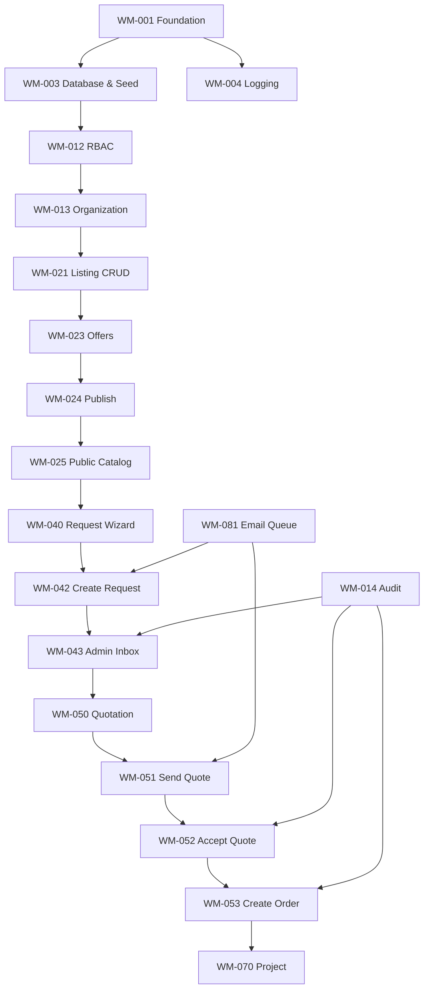

# Delivery Backlog — Website Marketplace

**Version:** 1.0-draft  
**Priority:** P0 = MVP/pilot blocker; P1 = post-MVP; P2 = scale/advanced  
**Estimates:** Not assigned; estimate after technical discovery and provider selection.

## 1. Delivery Rules

- Build in dependency order; do not parallelize stories before shared contracts/schema are stable.
- Every story must include UI, API, authorization, tests, analytics/event impact and documentation where applicable.
- Stories that involve money or sensitive data require backend validation and audit event.
- A feature is not done when UI works only with mocked data; happy path, bad path, empty/loading/error states and permission-denied behavior must be covered.
- Use feature flags for payment, partner seller, digital delivery and SaaS launch gates.

## 2. Suggested Release Sequence

| Release | Focus | Exit condition |
|---|---|---|
| R0 | Foundation | Deployable web/API, DB migration, auth base, CI, logging |
| R1 | Catalog MVP | Admin publishes listing/offer; visitor can search and view detail |
| R2 | Lead and quotation | Visitor submits request; admin quotes; customer accepts; order created |
| R3 | Pilot operations | Customer notifications, request dashboard, manual payment/order ops, security tests |
| R4 | Partner seller | Application, seller portal, listing moderation and seller-scoped access |
| R5 | Source delivery | Payment-confirmed entitlement, signed download, license and audit |
| R6 | SaaS commerce | Subscription, tenant provisioning, renewal and isolation |
| R7 | Marketplace scale | Ledger, commissions, payout and dispute workflows |

## 3. Epic Index

| Epic | Name | Phase | Priority |
|---|---|---|---|
| WM-EP00 | Project Foundation & Delivery Pipeline | R0 | P0 |
| WM-EP01 | Identity, Organization & Access Control | R0–R1 | P0 |
| WM-EP02 | Catalog, Listing & Offer Management | R1 | P0 |
| WM-EP03 | Seller Governance & Partner Portal | R4 | P1 |
| WM-EP04 | Custom Request & Lead Management | R2 | P0 |
| WM-EP05 | Quotation & Approval Workflow | R2 | P0 |
| WM-EP06 | Checkout, Order & Payment | R3–R5 | P0/P1 |
| WM-EP07 | Fulfillment, Project & Digital Delivery | R3–R5 | P0/P1 |
| WM-EP08 | Customer Portal, CMS & Notifications | R2–R4 | P0/P1 |
| WM-EP09 | SaaS Subscription & Tenant Provisioning | R6 | P2 |
| WM-EP10 | Commission, Ledger & Seller Payout | R7 | P2 |
| WM-EP11 | Quality, Security & Operations | All releases | P0 |

---

## 4. Story Backlog

### WM-EP00 — Project Foundation & Delivery Pipeline

#### WM-001 — Initialize monorepo and applications
**Priority:** P0 · **Phase:** R0 · **Depends on:** none

Tasks:
- [ ] Create workspace structure for Next.js web, NestJS API and shared contracts/config.
- [ ] Configure TypeScript strict mode, lint, formatter and path aliases.
- [ ] Add local Docker Compose for PostgreSQL, Redis and S3-compatible local storage.
- [ ] Add `.env.example`, typed env validation and secret-handling guidance.

Acceptance criteria:
- Developer can run web/API/worker and dependencies locally using documented commands.
- Missing/invalid required environment variables fail fast with a safe error.
- No secrets are committed; lockfile is committed.

#### WM-002 — Establish CI pipeline
**Priority:** P0 · **Phase:** R0 · **Depends on:** WM-001

Tasks: [ ] lint/typecheck [ ] unit test [ ] build [ ] dependency scan [ ] artifact upload/deploy staging.

Acceptance criteria:
- Pull request fails on lint, type, test or build failure.
- Deployment is environment-scoped; production requires approval.
- CI uses lockfile and reproducible commands.

#### WM-003 — Database migration and seed baseline
**Priority:** P0 · **Phase:** R0 · **Depends on:** WM-001

Tasks: [ ] configure ORM [ ] initial migration [ ] seed platform organization/seller [ ] seed admin role/permissions [ ] seed starter categories.

Acceptance criteria:
- Fresh database can migrate and seed without manual SQL.
- Seed is idempotent and does not create duplicate platform seller/category records.
- Migration status is visible in deployment logs.

#### WM-004 — Logging, correlation ID and error handling
**Priority:** P0 · **Phase:** R0 · **Depends on:** WM-001

Tasks: [ ] structured logger [ ] trace/correlation middleware [ ] standard API error filter [ ] redact secrets/PII.

Acceptance criteria:
- Every API request has a trace ID returned or logged.
- 4xx/5xx responses follow API error contract.
- Passwords, tokens, payment secrets and private file contents never appear in logs.

### WM-EP01 — Identity, Organization & Access Control

#### WM-010 — Customer account registration and email verification
**Priority:** P0 · **Phase:** R0–R1 · **Depends on:** WM-003, WM-081

Tasks: [ ] registration DTO/service [ ] email verification token [ ] verification email [ ] verified state [ ] tests.

Acceptance criteria:
- Registration normalizes email and prevents duplicate accounts.
- Verification token is single-use, expires and is stored hashed.
- Unverified users cannot perform actions requiring verified identity.
- User sees clear success, invalid-token and expired-token states.

#### WM-011 — Login, logout, password reset and session revocation
**Priority:** P0 · **Phase:** R0–R1 · **Depends on:** WM-010

Tasks: [ ] login [ ] secure cookie/session [ ] logout [ ] forgot/reset [ ] revoke sessions [ ] login throttling.

Acceptance criteria:
- Browser auth uses secure HttpOnly cookie/session or documented equivalent.
- Password reset token is single-use and short-lived.
- Login errors do not disclose whether an email exists.
- Rate limit/backoff prevents simple brute-force abuse.

#### WM-012 — Role and permission framework
**Priority:** P0 · **Phase:** R0 · **Depends on:** WM-003

Tasks: [ ] permission catalog [ ] role mapping [ ] guards/decorators [ ] policy service [ ] permission tests.

Acceptance criteria:
- Admin, support, customer and seller roles are represented.
- Every protected endpoint declares required permission/policy.
- Permission denied is tested at API level, not only hidden in UI.

#### WM-013 — Organization and membership management
**Priority:** P0 · **Phase:** R0–R1 · **Depends on:** WM-012

Tasks: [ ] organization service [ ] membership repository [ ] membership invitation/activation [ ] active organization context.

Acceptance criteria:
- User may belong to more than one organization with different roles.
- API derives organization scope from authorized membership.
- Client-supplied organization ID cannot grant access.

#### WM-014 — Audit log for sensitive actions
**Priority:** P0 · **Phase:** R0–R1 · **Depends on:** WM-004, WM-012

Tasks: [ ] audit schema [ ] audit service/interceptor [ ] admin search view [ ] retention configuration.

Acceptance criteria:
- Role changes, seller approval, listing publish/suspend, quotation send/accept, payment/refund and manual order state changes are audited.
- Audit events contain actor, action, resource, timestamp and correlation ID.
- Sensitive secrets/full payment payload are excluded.

### WM-EP02 — Catalog, Listing & Offer Management

#### WM-020 — Category and tag management
**Priority:** P0 · **Phase:** R1 · **Depends on:** WM-003, WM-012

Tasks: [ ] category CRUD [ ] parent-child rules [ ] slug validation [ ] tag CRUD [ ] active/inactive state.

Acceptance criteria:
- Admin can create/update/archive category and tag.
- Parent cycle and duplicate slug are rejected.
- Public endpoint returns only active categories/tags.

#### WM-021 — Listing CRUD and ownership
**Priority:** P0 · **Phase:** R1 · **Depends on:** WM-013, WM-020

Tasks: [ ] listing schema [ ] admin create/edit [ ] listing status [ ] slug handling [ ] list/detail admin screens.

Acceptance criteria:
- Every listing belongs to exactly one platform/seller organization.
- Admin can save draft and preview before publish.
- Archived listing is not hard-deleted and retains linked order history.

#### WM-022 — Listing media upload and gallery
**Priority:** P0 · **Phase:** R1 · **Depends on:** WM-001, WM-021

Tasks: [ ] asset service [ ] public/private bucket config [ ] upload validation [ ] image gallery sorting [ ] delete/reorder.

Acceptance criteria:
- Listing images are validated for file type/size and stored with generated object key.
- Only authorized editor can attach media to listing.
- Public listing media uses safe CDN URL; private attachments are never public.

#### WM-023 — Offer and pricing management
**Priority:** P0 · **Phase:** R1 · **Depends on:** WM-021

Tasks: [ ] offer CRUD [ ] fulfillment/pricing enums [ ] price versioning [ ] scope/license fields [ ] compatibility validation.

Acceptance criteria:
- Listing supports multiple offers.
- Offer captures fulfillment type, pricing model, currency and scope.
- Invalid combinations are rejected by backend validation.
- Updating price creates new effective price record and does not alter historical order snapshot.

#### WM-024 — Listing publish and moderation rules
**Priority:** P0 · **Phase:** R1 · **Depends on:** WM-021, WM-023

Tasks: [ ] publish validator [ ] publish/suspend actions [ ] moderation notes [ ] transition tests.

Acceptance criteria:
- Listing cannot publish without required title, category, media/preview policy and at least one valid offer or explicit contact CTA.
- Only authorized admin can publish/suspend in MVP.
- Public query excludes all non-published/suspended listings.

#### WM-025 — Public catalog listing and category pages
**Priority:** P0 · **Phase:** R1 · **Depends on:** WM-020, WM-024

Tasks: [ ] public listing DTO [ ] category page [ ] listing cards [ ] pagination [ ] loading/empty/error states.

Acceptance criteria:
- Visitor can browse public listings without login.
- Cards show title, category, seller, fulfillment and price label where applicable.
- Draft/internal fields are absent from payload.
- Page is usable on mobile and desktop.

#### WM-026 — Public search and filters
**Priority:** P0 · **Phase:** R1 · **Depends on:** WM-025

Tasks: [ ] title/summary search [ ] category filter [ ] fulfillment/pricing filter [ ] tag/feature filter [ ] URL state [ ] indexes.

Acceptance criteria:
- Search and filters can be combined.
- Filter state is shareable via URL query parameters.
- Invalid filter values are safely ignored or rejected consistently.
- Results remain restricted to eligible published listings.

#### WM-027 — Listing detail and demo experience
**Priority:** P0 · **Phase:** R1 · **Depends on:** WM-023, WM-025

Tasks: [ ] detail API [ ] screenshot gallery [ ] offer selector [ ] seller profile teaser [ ] demo external link policy [ ] SEO metadata.

Acceptance criteria:
- Detail page explains scope, exclusions, fulfillment, seller, support and commercial offers.
- Demo is clearly identified as external/approved embed.
- No arbitrary seller URL is server-fetched or proxied.
- Metadata/canonical URL is rendered for public SEO.

### WM-EP03 — Seller Governance & Partner Portal

#### WM-030 — Seller application and review
**Priority:** P1 · **Phase:** R4 · **Depends on:** WM-013, WM-014

Tasks: [ ] application form [ ] private document upload [ ] review queue [ ] approve/reject/request changes [ ] email updates.

Acceptance criteria:
- Seller application has explicit status and reviewer.
- Only approved seller can submit listing for publication.
- Review documents are private and access is audited.

#### WM-031 — Seller portal profile and team
**Priority:** P1 · **Phase:** R4 · **Depends on:** WM-030

Tasks: [ ] seller dashboard shell [ ] profile management [ ] staff invitation [ ] organization role management.

Acceptance criteria:
- Seller owner can update permitted profile fields and invite staff.
- Staff access follows seller-specific permissions.
- Seller cannot access another seller's profile/team.

#### WM-032 — Seller listing self-service
**Priority:** P1 · **Phase:** R4 · **Depends on:** WM-024, WM-031

Tasks: [ ] seller listing draft [ ] offer editor [ ] submit revision [ ] moderation feedback [ ] status display.

Acceptance criteria:
- Seller can only create/edit listing owned by current seller organization.
- Submitted revision is frozen for review.
- Published listing changes that affect price/scope require a new revision/re-review.

#### WM-033 — Seller lead and order inbox
**Priority:** P1 · **Phase:** R4 · **Depends on:** WM-032, WM-044, WM-060

Tasks: [ ] seller-scoped lead list [ ] authorized request detail [ ] order item list [ ] notifications.

Acceptance criteria:
- Seller sees only requests/orders routed to their organization.
- Internal platform-only notes are not visible to seller unless explicitly shared.
- All seller actions are audited.

### WM-EP04 — Custom Request & Lead Management

#### WM-040 — Custom project wizard UI
**Priority:** P0 · **Phase:** R2 · **Depends on:** WM-025

Tasks: [ ] define form schema [ ] stepper UI [ ] conditional fields [ ] “not sure” options [ ] review step [ ] responsive states.

Acceptance criteria:
- Visitor can complete the form without knowing technical stack details.
- Required fields are validated per step and again on backend.
- User can navigate back without losing inputs.
- Form displays a review summary before submit.

#### WM-041 — Request attachment upload
**Priority:** P0 · **Phase:** R2 · **Depends on:** WM-022

Tasks: [ ] upload intent [ ] MIME/extension/size validation [ ] private storage [ ] malware scan status [ ] request attachment binding.

Acceptance criteria:
- Only allowed file types/size can be uploaded.
- File stays private and inaccessible until scan passes.
- Upload cannot be attached to a request outside the authorized upload token/session.

#### WM-042 — Create request and reference confirmation
**Priority:** P0 · **Phase:** R2 · **Depends on:** WM-040, WM-041, WM-081

Tasks: [ ] create request endpoint [ ] reference code generator [ ] requirements snapshot [ ] outbox event [ ] success screen.

Acceptance criteria:
- Submission creates exactly one request under retry/idempotency conditions.
- API returns unpredictable reference code, not sequential ID.
- Contact and requirements are stored with schema version/snapshot.
- Customer receives acknowledgement asynchronously.

#### WM-043 — Admin request inbox and filters
**Priority:** P0 · **Phase:** R2 · **Depends on:** WM-042, WM-012

Tasks: [ ] request table [ ] filters/search [ ] detail page [ ] priority badge [ ] assignment display.

Acceptance criteria:
- Admin can search by reference/contact/title and filter by status/assigned owner/date.
- PII is shown only to authorized staff.
- List is paginated and indexes support common filters.

#### WM-044 — Assign, transition and internal note
**Priority:** P0 · **Phase:** R2 · **Depends on:** WM-043, WM-014

Tasks: [ ] assignment action [ ] transition service [ ] allowed transition map [ ] internal note composer [ ] activity timeline.

Acceptance criteria:
- Only allowed transitions succeed.
- Every transition records actor/from/to/time/reason.
- Internal notes are excluded from customer/seller response DTO.
- Assignment changes notify the assigned owner.

#### WM-045 — Customer-visible request messaging
**Priority:** P1 · **Phase:** R4 · **Depends on:** WM-044, WM-080

Tasks: [ ] message thread [ ] attachment policy [ ] unread/read state [ ] customer notification.

Acceptance criteria:
- Customer and authorized staff can exchange customer-visible messages.
- Internal notes remain separate and invisible.
- Messages are immutable or edits are versioned/audited.

### WM-EP05 — Quotation & Approval Workflow

#### WM-050 — Create quotation draft with line items
**Priority:** P0 · **Phase:** R2 · **Depends on:** WM-044

Tasks: [ ] quotation header [ ] version model [ ] line item editor [ ] totals calculator [ ] scope/terms editor.

Acceptance criteria:
- Admin can create draft against request and select seller/delivery owner.
- Backend computes line/header totals with integer money arithmetic.
- Quotation stores currency, validity, included/excluded scope, payment terms and version.

#### WM-051 — Send quotation and notify customer
**Priority:** P0 · **Phase:** R2 · **Depends on:** WM-050, WM-081

Tasks: [ ] send transition [ ] immutable version freeze [ ] secure view link [ ] email template [ ] expiry job.

Acceptance criteria:
- Sending freezes a version and records sentAt/validUntil.
- Later edits create a new version and mark old version superseded where applicable.
- Email contains secure link; link does not expose sequential IDs or private data.

#### WM-052 — Customer quotation view, accept and reject
**Priority:** P0 · **Phase:** R2 · **Depends on:** WM-051, WM-010

Tasks: [ ] quotation portal page [ ] access/identity check [ ] accept/reject action [ ] acceptance audit [ ] stale/expired states.

Acceptance criteria:
- Customer sees exact version, scope, exclusions, line items, totals and validity.
- Acceptance is rejected if version is stale, expired, superseded or already acted upon.
- Accept/reject actor, time, terms version and optional note are stored.

#### WM-053 — Convert accepted quotation to order
**Priority:** P0 · **Phase:** R2 · **Depends on:** WM-052, WM-060

Tasks: [ ] conversion transaction [ ] order snapshot [ ] unique source quote constraint [ ] outbox event [ ] duplicate retry tests.

Acceptance criteria:
- Accepting an eligible quotation creates one order and order items from immutable snapshot.
- Concurrent duplicate acceptance cannot create duplicate orders.
- Request status changes to converted/won according to business rule.

### WM-EP06 — Checkout, Order & Payment

#### WM-060 — Order and order item snapshot
**Priority:** P0 · **Phase:** R2–R3 · **Depends on:** WM-023, WM-050

Tasks: [ ] order schema [ ] order item snapshot [ ] order status transition [ ] order number [ ] customer/admin detail DTO.

Acceptance criteria:
- Order stores customer, seller, currency and financial totals.
- Order item retains listing/offer/scope/license/price snapshot after source listing changes.
- Order history is not deleted when listing or seller is archived.

#### WM-061 — Manual/offline payment recording
**Priority:** P0 · **Phase:** R3 · **Depends on:** WM-060, WM-014

Tasks: [ ] payment record [ ] admin permission [ ] reference/proof metadata [ ] confirm state service [ ] audit.

Acceptance criteria:
- Admin with finance permission can record offline payment with amount, currency, reference and evidence metadata.
- Amount/currency must match due amount or require explicit partial-payment workflow.
- Manual record is audited and cannot be silently overwritten.

#### WM-062 — Payment provider adapter and checkout
**Priority:** P1 · **Phase:** R5 · **Depends on:** WM-060, provider selection

Tasks: [ ] payment interface [ ] provider adapter [ ] checkout session [ ] sandbox integration [ ] failure/cancel handling.

Acceptance criteria:
- Domain services depend on provider interface, not provider SDK types.
- Checkout returns pending/action-required state until server confirmation.
- Frontend redirect alone cannot mark order paid.

#### WM-063 — Verified webhook and reconciliation
**Priority:** P1 · **Phase:** R5 · **Depends on:** WM-062, WM-004

Tasks: [ ] raw body signature verification [ ] provider event table [ ] unique event ID [ ] async processor [ ] reconciliation job.

Acceptance criteria:
- Invalid signature rejected.
- Duplicate event is safely ignored.
- Amount, currency, reference and current payment state are validated.
- Unmatched/pending events surface in operations dashboard/alert.

#### WM-064 — Refund workflow
**Priority:** P1 · **Phase:** R5 · **Depends on:** WM-062, WM-063

Tasks: [ ] refund request [ ] permission/approval [ ] provider refund [ ] partial refund math [ ] notifications.

Acceptance criteria:
- Refund record has amount, reason, actor and status.
- Refund total cannot exceed captured amount less prior successful refunds.
- Order/payment states update only after confirmed refund processing.

### WM-EP07 — Fulfillment, Project & Digital Delivery

#### WM-070 — Create project from managed/custom order
**Priority:** P0 · **Phase:** R3 · **Depends on:** WM-053, WM-060

Tasks: [ ] project creation policy [ ] project scope snapshot [ ] delivery owner [ ] project reference [ ] tests.

Acceptance criteria:
- Managed/custom order can create at most one project.
- Project scope is copied from accepted order/quotation and is not changed by later listing edits.
- Project owner and customer organization are explicit.

#### WM-071 — Project milestones and delivery tracking
**Priority:** P1 · **Phase:** R4 · **Depends on:** WM-070

Tasks: [ ] milestone CRUD [ ] customer read view [ ] progress/status actions [ ] timeline [ ] notifications.

Acceptance criteria:
- Authorized customer and delivery team can view relevant milestones.
- State transitions are validated and audited.
- Customer cannot modify internal delivery progress.

#### WM-072 — Deliverables and customer acceptance
**Priority:** P1 · **Phase:** R4 · **Depends on:** WM-071, WM-041

Tasks: [ ] private deliverable upload [ ] version metadata [ ] acceptance/change request [ ] delivery email.

Acceptance criteria:
- Deliverables are private and downloadable only by authorized members.
- Customer acceptance/change request references a milestone/deliverable version.
- Final acceptance timestamp and actor are recorded.

#### WM-073 — Digital entitlement and source download
**Priority:** P1 · **Phase:** R5 · **Depends on:** WM-063, WM-022

Tasks: [ ] entitlement model [ ] license snapshot [ ] paid-order trigger [ ] signed URL [ ] download events [ ] revoke.

Acceptance criteria:
- Entitlement is granted exactly once after trusted payment/order confirmation.
- Download URL is short-lived and not persisted as public URL.
- Unauthorized user, unpaid order, revoked entitlement or infected asset is denied.
- Download event is recorded and revocation is audited.

### WM-EP08 — Customer Portal, CMS & Notifications

#### WM-080 — Customer portal overview and history
**Priority:** P1 · **Phase:** R4 · **Depends on:** WM-010, WM-042, WM-060

Tasks: [ ] account shell [ ] requests list/detail [ ] quotation list/detail [ ] order list/detail [ ] permission tests.

Acceptance criteria:
- Customer sees only their own or organization-authorized records.
- Empty/loading/error states exist for each page.
- Guest request can be linked only after approved verification flow.

#### WM-081 — Transactional email and notification queue
**Priority:** P0 · **Phase:** R2 · **Depends on:** WM-001, WM-004

Tasks: [ ] email provider interface [ ] templates [ ] queue/outbox worker [ ] retry/backoff [ ] delivery log [ ] preview/test mode.

Acceptance criteria:
- Request acknowledgement and quotation/order notifications are queued, not sent in API request path.
- Failed delivery retries according to policy and eventually alerts operations.
- Templates support Vietnamese and safe variable escaping.
- No sensitive file content or internal notes in emails.

#### WM-082 — CMS content management
**Priority:** P1 · **Phase:** R4 · **Depends on:** WM-012

Tasks: [ ] pages [ ] FAQ [ ] homepage sections [ ] SEO metadata [ ] preview/publish.

Acceptance criteria:
- Authorized admin can draft, preview, publish and archive content.
- Public endpoints expose only published content.
- Rich text is sanitized.

#### WM-083 — Reviews and moderation
**Priority:** P1 · **Phase:** R4 · **Depends on:** WM-072, WM-060

Tasks: [ ] eligibility service [ ] review form [ ] moderation queue [ ] seller/listing summary stats.

Acceptance criteria:
- Review requires eligible fulfilled order item.
- One review per eligible order item/customer.
- Hidden/rejected reviews do not affect public rating.

### WM-EP09 — SaaS Subscription & Tenant Provisioning

#### WM-090 — SaaS plans and subscription lifecycle
**Priority:** P2 · **Phase:** R6 · **Depends on:** WM-062, WM-023

Tasks: [ ] plan model [ ] recurring price [ ] trial policy [ ] subscription webhook mapping [ ] renewal/cancel states [ ] dunning.

Acceptance criteria:
- Subscription transitions are tested for success, failure, grace period and cancellation.
- Plan/price/entitlements are snapshotted at subscription start.
- Failed payment does not immediately delete tenant data.

#### WM-091 — Tenant provisioning adapter
**Priority:** P2 · **Phase:** R6 · **Depends on:** WM-090

Tasks: [ ] tenant model [ ] provisioning job/outbox [ ] provisioner interface [ ] retries/dead-letter [ ] owner membership creation.

Acceptance criteria:
- Same subscription event cannot provision duplicate tenant.
- Tenant is marked ACTIVE only after ready check.
- Failed provisioning can be retried safely and is visible to operations.

#### WM-092 — Tenant authorization and isolation
**Priority:** P2 · **Phase:** R6 · **Depends on:** WM-091, WM-012

Tasks: [ ] tenant context resolver [ ] scoped repository [ ] tenant middleware/guard [ ] cross-tenant test suite [ ] support access audit.

Acceptance criteria:
- Missing tenant context fails closed.
- User from tenant A cannot read/update/export/download tenant B data.
- Support access is permissioned, reason-coded and audited.

#### WM-093 — Usage metering and domain mapping
**Priority:** P2 · **Phase:** R6 · **Depends on:** WM-091

Tasks: [ ] usage event schema [ ] dedupe [ ] quota evaluation [ ] domain verification [ ] tenant routing.

Acceptance criteria:
- Usage event is idempotent and attributable to tenant/product/period.
- Custom domain is not activated before ownership verification.
- Quota behavior is documented and tested at boundary values.

### WM-EP10 — Commission, Ledger & Seller Payout

#### WM-100 — Immutable seller ledger
**Priority:** P2 · **Phase:** R7 · **Depends on:** WM-063, WM-033

Tasks: [ ] account model [ ] ledger entry schema [ ] fee calculation snapshot [ ] reconciliation report [ ] reversal entries.

Acceptance criteria:
- Posted ledger entries cannot be edited/deleted.
- Reversal uses compensating entry.
- Every payable amount can be traced to source payment/order/refund.
- Ledger balances reconcile against payment provider and order totals.

#### WM-101 — Commission rules
**Priority:** P2 · **Phase:** R7 · **Depends on:** WM-100

Tasks: [ ] platform fee policy [ ] per-seller/category overrides if needed [ ] effective date [ ] snapshot fee at order time.

Acceptance criteria:
- Commission is calculated on server and snapshotted per transaction.
- Historical commission does not change when policy is edited.
- Rules have explicit precedence and effective dates.

#### WM-102 — Seller payout workflow
**Priority:** P2 · **Phase:** R7 · **Depends on:** WM-100, WM-101

Tasks: [ ] payout request/batch [ ] eligibility checks [ ] maker-checker approval [ ] provider transfer adapter [ ] reconciliation/failure handling.

Acceptance criteria:
- Payout cannot exceed eligible available ledger balance.
- Approval and execution are separate permissions.
- Transfer is idempotent and provider transfer reference is stored.
- Failed/reversed payout generates compensating ledger events and operations alert.

### WM-EP11 — Quality, Security & Operations

#### WM-110 — Authorization and security regression suite
**Priority:** P0 · **Phase:** All · **Depends on:** WM-012

Tasks: [ ] IDOR tests [ ] seller scope tests [ ] internal note leakage tests [ ] CSRF/XSS tests [ ] upload abuse tests [ ] webhook spoof tests.

Acceptance criteria:
- CI includes high-risk authorization tests.
- Public/customer/seller/admin access matrix is exercised.
- Security regressions fail the pipeline.

#### WM-111 — Critical journey E2E tests
**Priority:** P0 · **Phase:** R1–R3 · **Depends on:** WM-027, WM-042, WM-053, WM-070

Tasks: [ ] browse listing [ ] submit request [ ] admin quote [ ] customer accept [ ] order/project created [ ] email assertion.

Acceptance criteria:
- Happy path and negative cases are automated in staging-like environment.
- Tests cover expired quote, duplicate submit, unauthorized request access and duplicate acceptance.

#### WM-112 — Backup, restore and incident runbooks
**Priority:** P0 · **Phase:** R3 · **Depends on:** WM-003, WM-004

Tasks: [ ] DB backup [ ] object storage backup/versioning [ ] restore procedure [ ] payment incident runbook [ ] email/queue incident runbook.

Acceptance criteria:
- A restore drill is completed before production pilot.
- Runbook identifies owner, alert, diagnosis, mitigation and escalation.
- RPO/RTO are explicitly documented and approved.

#### WM-113 — Catalog and request performance testing
**Priority:** P1 · **Phase:** R3 · **Depends on:** WM-026, WM-042

Tasks: [ ] target load profile [ ] catalog search load test [ ] form submit load test [ ] query/index review [ ] report.

Acceptance criteria:
- Test report identifies throughput, p95 latency, error rate and bottlenecks.
- No unbounded query or unindexed admin list path remains at expected load.

#### WM-114 — Accessibility and responsive QA
**Priority:** P0 · **Phase:** R1–R3 · **Depends on:** WM-025, WM-040

Tasks: [ ] keyboard audit [ ] label/error association [ ] contrast audit [ ] responsive breakpoints [ ] screen reader smoke test.

Acceptance criteria:
- Catalog filters and request wizard are operable by keyboard.
- Form fields have labels and field errors are programmatically associated.
- Layout is verified on supported mobile/tablet/desktop breakpoints.

---

## 5. Dependency Map (Critical Path)

## 6. Sprint/Iteration Planning Guidance

Do not commit to calendar duration before team size, design readiness, payment provider and hosting are known. A practical iteration order is:

1. **Foundation sprint:** WM-001–004, base schema and API contract.
2. **Identity/catalog admin sprint:** WM-010–014, WM-020–024.
3. **Public catalog sprint:** WM-025–027 and responsive/SEO.
4. **Lead workflow sprint:** WM-040–044, WM-081.
5. **Quotation/order sprint:** WM-050–061, WM-070.
6. **Pilot hardening sprint:** WM-110–114, operations and acceptance tests.
7. **Partner/digital delivery:** WM-030–033, WM-073, WM-080.
8. **SaaS/payout only after validated demand and commercial/legal policy.**

## 7. Definition of Ready (DoR)

A story is ready when:
- [ ] User/problem and actor are clear.
- [ ] Acceptance criteria are testable.
- [ ] UX wireframe/content requirements exist for non-trivial UI.
- [ ] API and data impact are identified.
- [ ] Permission and privacy impact are documented.
- [ ] Dependencies and external provider requirements are known.
- [ ] Edge cases and failure states are identified.

## 8. Definition of Done (DoD)

A story is done when:
- [ ] Acceptance criteria pass on staging.
- [ ] Backend validates input and authorization independently of frontend.
- [ ] Unit/integration/E2E tests appropriate to risk pass.
- [ ] Loading, empty, error and permission-denied UI states are covered.
- [ ] Logs/audit/metrics are added where required.
- [ ] API docs and environment examples are updated.
- [ ] Migration and seed are reproducible.
- [ ] No secrets or private data leak in response/logs.
- [ ] Code review and regression checks pass.

## 9. Test Case Matrix for MVP

| ID | Scenario | Expected |
|---|---|---|
| TC-MVP-01 | Visitor browses published listing | Listing appears |
| TC-MVP-02 | Visitor requests draft listing URL | 404/not public |
| TC-MVP-03 | Visitor filters catalog by category and fulfillment | Matching published results only |
| TC-MVP-04 | Visitor submits valid custom request | One request + reference + email queued |
| TC-MVP-05 | Visitor submits malformed contact | 422 with field errors |
| TC-MVP-06 | Visitor uploads disallowed file | Rejected, no accessible asset |
| TC-MVP-07 | Repeat submit with same idempotency key | No duplicate request |
| TC-MVP-08 | Admin assigns request | Owner and activity updated |
| TC-MVP-09 | Admin tries invalid request transition | 409 state conflict |
| TC-MVP-10 | Admin adds internal note | Customer API does not expose note |
| TC-MVP-11 | Admin sends quotation | Immutable version + notification queued |
| TC-MVP-12 | Customer accepts current valid quote | One order created |
| TC-MVP-13 | Customer accepts expired quote | Rejected; no order |
| TC-MVP-14 | Customer accepts stale quote version | Rejected; no order |
| TC-MVP-15 | Two concurrent accept requests | Only one order |
| TC-MVP-16 | Seller A queries Seller B listing/order | Denied/not found |
| TC-MVP-17 | Unauthenticated visitor calls admin API | 401 |
| TC-MVP-18 | Customer accesses another customer's request | Denied/not found |
| TC-MVP-19 | Email provider temporarily fails | Job retries; request remains created |
| TC-MVP-20 | Admin records offline payment with mismatched amount | Rejected or explicit partial-payment flow |

---

**End of Backlog**
