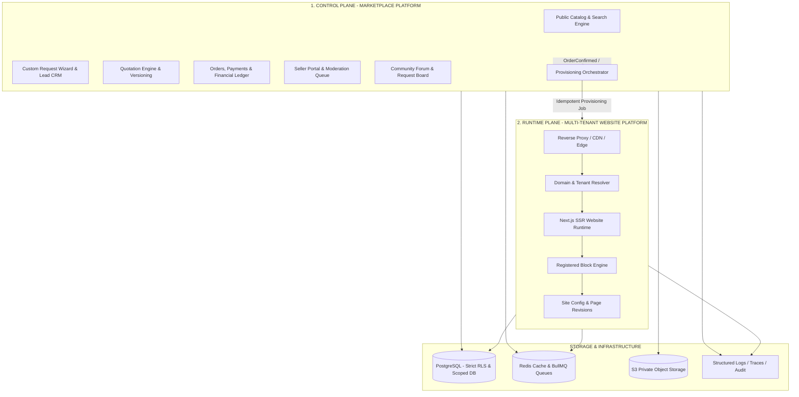
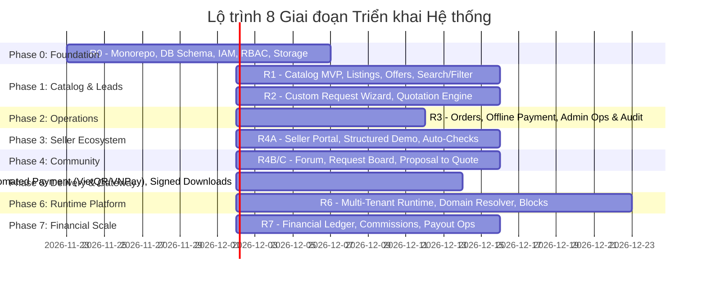
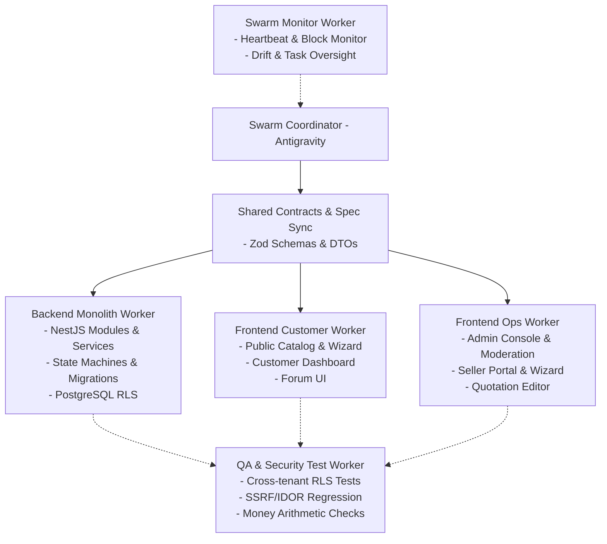

# BÁO CÁO PHÂN TÍCH ĐẶC TẢ & KẾ HOẠCH TRIỂN KHAI HỆ THỐNG

**Dự án:** Website Solution Marketplace & Multi-Tenant Template Platform  
**Tài liệu phân tích:** Toàn bộ thư mục `website-marketplace-spec-v1.1` (13 tài liệu, 2 phụ lục mở rộng và báo cáo đánh giá v1.1)  
**Trạng thái:** Bản phân tích kỹ thuật & Đề xuất phân kỳ (Đã hoàn thiện tài liệu hợp nhất — Chuẩn bị thực hiện Giai đoạn 1)  
**Ngày cập nhật:** 22/11/2026  
**Quy chuẩn kỹ thuật bắt buộc:** `DEV_RULES.md`

---

## 1. TỔNG QUAN DỰ ÁN VÀ TẦM NHÌN SẢN PHẨM

### 1.1 Mục tiêu nền tảng
Website Marketplace là nền tảng thương mại dịch vụ số và runtime tập trung giúp khách hàng (cá nhân, doanh nghiệp nhỏ và vừa) khám phá, xem demo, mua bản quyền mã nguồn hoặc thuê trọn gói các giải pháp website thuộc nhiều lĩnh vực; đồng thời tiếp nhận và điều phối các yêu cầu phát triển phần mềm tùy biến khi giải pháp có sẵn chưa đáp ứng 100% nhu cầu.

Nền tảng vận hành theo mô hình **Hybrid Marketplace (Sàn lai đa mặt)**:
- **First-party (Platform):** Nền tảng tự nghiên cứu, sở hữu, phát hành và cung cấp các bộ template/mã nguồn giải pháp tiêu chuẩn.
- **Third-party (Partner/Seller):** Mạng lưới Freelancer, Studio, Agency công nghệ đã vượt qua quy trình thẩm định năng lực (`APPROVED`), ký kết Seller Agreement có hiệu lực pháp lý và đăng bán giải pháp hoặc gửi báo giá nhận thầu.
- **Customer (Buyer):** Người mua tìm kiếm theo ngành nghề, trải nghiệm demo có kiểm chứng, chọn phương thức bàn giao phù hợp, nhận báo giá chi tiết và theo dõi tiến độ dự án.
- **Community (Thành viên):** Không gian thảo luận chuyên môn, hỏi đáp kỹ thuật (`Q&A`), chia sẻ dự án (`Showcase`) và đăng bài tìm kiếm giải pháp (`Wanted Request Board`).

### 1.2 Ma trận Hình thức Bàn giao & Định giá (Fulfillment × Pricing Matrix)
Một giải pháp được niêm yết (**Listing**) có thể cung cấp nhiều lựa chọn thương mại (**Offers**). Mỗi Offer ràng buộc chặt chẽ phương thức bàn giao và mô hình định giá:

| Fulfillment Type | Pricing Model phù hợp | Bản chất bàn giao cho khách | Kênh bàn giao |
|---|---|---|---|
| **SOURCE_CODE** | `FIXED` / `QUOTE` | File mã nguồn hoàn chỉnh, tài liệu hướng dẫn, giấy phép sử dụng (License Terms) | Cấp quyền tải số (`digital_entitlements`), link tải ký số S3 presigned URL bảo mật có thời hạn (5–15 phút). |
| **MANAGED_SERVICE** | `FIXED` / `STARTING_AT` / `QUOTE` | Website hoàn chỉnh đã tùy biến giao diện, kết nối domain, cấu hình hosting/SSL | Quy trình quản lý dự án (`projects`): Khởi động $\to$ Mốc thực hiện $\to$ Staging Review $\to$ Nghiệm thu $\to$ Bàn giao. |
| **SAAS** | `SUBSCRIPTION` / `QUOTE` | Tài khoản và một Site/Tenant website độc lập hoạt động trên hạ tầng chung | Tự động kích hoạt (`provisioning_jobs`), quản trị vòng đời thuê bao (`subscriptions`). |
| **CUSTOM_PROJECT** | `QUOTE` | Sản phẩm phát triển theo hợp đồng / Statement of Work (SOW) riêng | Dự án theo mốc bàn giao, thanh toán chia đợt (Deposit / Milestones / Handover). |

*Quy tắc nghiệp vụ cốt lõi:* Cấm mọi tổ hợp không hợp lệ (ví dụ: `SOURCE_CODE + SUBSCRIPTION` mặc định bị chặn ở MVP). Mọi đơn hàng (`Order`) và báo giá (`Quotation`) đều phải lưu snapshot thương mại bất biến; việc sửa giá hoặc xóa Listing sau này tuyệt đối không làm sai lệch lịch sử giao dịch.

---

## 2. KIẾN TRÚC HỆ THỐNG: PHÂN TÁCH HAI LOGICAL PLANES

Để đảm bảo hiệu năng, tính bảo mật và khả năng mở rộng trong tương lai mà không sa vào bẫy chia tách Microservices quá sớm, kiến trúc hệ thống áp dụng mô hình **Modular Monolith** phân tách logic thành 2 Plane độc lập:

### 2.1 Control Plane (Marketplace Platform)
- Quản lý định danh người dùng (`IdentityModule`), quyền hạn theo vai trò (`AccessControlModule`) và tổ chức (`OrganizationModule`).
- Quản lý danh mục giải pháp (`CatalogModule`), phân loại đa tầng (`categories`, `tags`, `feature_definitions`) và cấu hình gói thương mại (`OfferModule`).
- Tiếp nhận lead, xử lý yêu cầu tùy biến (`RequestModule`), lập báo giá có phiên bản (`QuotationModule`).
- Xử lý giỏ hàng, đặt hàng (`CheckoutModule`), đối soát thanh toán (`PaymentModule`) và lưu trữ sổ cái tài chính (`LedgerModule`).
- Cung cấp cổng thông tin đối tác (`SellerModule`), hàng đợi kiểm duyệt (`ModerationQueue`) và diễn đàn cộng đồng (`CommunityModule`).

### 2.2 Website Runtime Plane (Multi-Tenant Platform)
- Tiếp nhận HTTP request công khai thông qua Hostname.
- **Domain Resolver:** Chuẩn hóa Hostname $\to$ Tra cứu `site_domains` $\to$ Xác định `sites` và `tenants`.
- **Registered Block Engine:** Nạp cấu hình Site (`site_configuration`) và Template Version đã được đóng băng.
- Render động giao diện thông qua bộ Block Catalog chuẩn (Hero, RichText, Features, ContactForm, Testimonials...), cấm tuyệt đối việc thực thi mã JavaScript/HTML tùy ý do người dùng tải lên DB (`eval-free`).
- Cách ly bộ nhớ đệm (Cache Isolation) dựa trên composite key `(site_id, template_version, config_revision, page_revision)`.

---

## 3. PHÂN TÍCH HAI MẢNH GHÉP MỞ RỘNG (V1.1 ADDENDA)

### 3.1 Quy trình Thẩm định Seller & Kiểm duyệt Demo Đa phương thức (R4A)
Tài liệu `SELLER_SUBMISSION_AND_DEMO_SPEC.md` bổ sung các chuẩn mực phòng ngừa rủi ro lừa đảo, mã độc và vi phạm bản quyền:
1. **Tiền thẩm định hồ sơ:** Seller phải trải qua xét duyệt danh tính, năng lực và ký chấp thuận Seller Agreement có ghi nhận IP Hash và phiên bản điều khoản trước khi được phép gửi Listing.
2. **Cấu trúc Demo bắt buộc:**
   - Tối thiểu phải có bộ ảnh chụp chức năng (`SCREENSHOTS` $\ge$ 4 ảnh chất lượng cao) **và** một trong các hình thức:
     - `EXTERNAL_LINK`: Link seller tự host, hệ thống gắn nhãn cảnh báo điều hướng ra ngoài, mở tab mới với thuộc tính `rel="noopener noreferrer"`.
     - `APPROVED_EMBED`: Iframe nhúng trực tiếp nhưng chỉ cho phép các domain nằm trong `embed_allowlist` được kiểm duyệt, chạy trong `sandbox` hạn chế và áp dụng CSP `frame-src`.
     - `VIDEO`: Video walkthrough lưu trữ trên nhà cung cấp cho phép.
     - `SANDBOX_ACCOUNT`: Tài khoản dùng thử, mật khẩu mã hóa trong DB, tự động reset định kỳ, tuyệt đối không xuất hiện trong public API hoặc nhật ký log.
3. **Pipeline kiểm tra tự động (Auto-check Pipeline):** Chạy trên worker cô lập trước khi chuyển bài vào hàng đợi Reviewer:
   - Chặn đứng lỗ hổng SSRF (chặn IP nội bộ, localhost, metadata endpoint `169.254.169.254`).
   - Kiểm tra mã phản hồi HTTP của link demo (timeout tối đa 5 giây).
   - Quét mã độc, virus, tệp thực thi lạ và rà soát file `.env` rò rỉ khóa bảo mật trong các gói mã nguồn tải lên.
4. **Hoán đổi nguyên tử (Atomic Swap):** Khi Seller cập nhật Listing đang hoạt động, hệ thống sinh ra một `listing_revisions` mới. Bản live cũ vẫn giữ nguyên để phục vụ khách hàng. Chỉ khi Reviewer nhấn `APPROVE`, con trỏ `current_published_revision_id` mới được cập nhật tức thời sang bản mới.

### 3.2 Diễn đàn Cộng đồng & Bảng Yêu cầu "Cần giải pháp" (R4B & R4C)
Tài liệu `COMMUNITY_FORUM_SPEC.md` cung cấp cơ chế tương tác và tạo phễu khách hàng khép kín:
1. **Phân loại bài viết chuyên biệt:**
   - `DISCUSSION`: Thảo luận mở về kỹ thuật web.
   - `QUESTION`: Hỏi đáp chuyên môn, người hỏi có quyền chọn "Câu trả lời được chấp nhận" (`Accepted Answer`).
   - `SHOWCASE`: Giới thiệu sản phẩm hoàn thiện, cho phép gắn thẻ Listing có sẵn trong Marketplace.
   - `WANTED`: Khách hàng đăng bài tìm kiếm giải pháp với ngân sách, thời hạn và yêu cầu cụ thể.
2. **Cơ chế Proposal bảo mật & Chống giao dịch ngầm (Disintermediation Prevention):**
   - Chỉ có Seller xác minh (`APPROVED`) mới được gửi `PROPOSAL` vào bài đăng `WANTED`.
   - Nội dung Proposal mang tính riêng tư (chỉ người đăng bài và staff mới xem được), tránh việc đối thủ cạnh tranh phá giá hoặc sao chép ý tưởng.
   - Khi người đăng bài chọn "Tiếp tục với proposal này", hệ thống tự động khởi tạo một `QUOTE_REQUEST` lưu trữ `source_proposal_id` và `source_thread_id`, đưa khách hàng vào quy trình Báo giá $\to$ Hợp đồng $\to$ Đơn hàng chính thống của sàn.
   - Bộ lọc phát hiện thông tin liên lạc ngoài luồng: Tự động che số điện thoại, link Telegram/Zalo đối với tài khoản mới (Trust Level TL0/TL1).

---

## 4. CHUẨN HÓA MÔ HÌNH DỮ LIỆU & RÀNG BUỘC KỸ THUẬT (DATA RECONCILIATION)

Dựa trên các phát hiện trong `SPEC_REVIEW_REPORT.md`, hệ thống thống nhất chuẩn hóa các điểm sau:

1. **Loại bỏ hoàn toàn bảng `saas_tenants`:** Áp dụng mô hình chuẩn hóa từ `MULTI_TENANT_TEMPLATE_ARCHITECTURE.md`:
   - `tenants`: Đại diện cho workspace sở hữu website của khách hàng.
   - `sites`: Đại diện cho một website cụ thể (một Tenant có thể sở hữu nhiều Site).
   - `site_domains`: Quản lý danh sách hostname chuẩn hóa toàn cục, phân biệt subdomain sàn và custom domain đã xác minh DNS TXT.
2. **Tách biệt `Organization` và `Tenant`:**
   - `organizations` thuộc tầng Marketplace thương mại (Platform, Partner Seller, Customer Account).
   - `tenants` thuộc tầng Website Runtime (quản lý phân quyền CMS và dữ liệu bài viết/sản phẩm của website).
3. **Quy tắc tiền tệ theo `DEV_RULES.md`:**
   - Tiền luôn lưu bằng số nguyên minor units (`bigint`). Đối với VND lưu đồng nguyên; USD lưu cents.
   - Cấm 100% việc dùng kiểu số thực (`float`/`double`) trong TypeScript/JavaScript để tính tiền.
   - Phải sử dụng module `Money` tập trung để xử lý cộng, trừ, nhân tỉ lệ, làm tròn và chiết khấu.
4. **Snapshot thương mại bất biến:**
   - `quotation_versions` và `order_items` lưu trữ toàn bộ giá, thuế, tên gói, phạm vi công việc (`scope_snapshot`) và điều khoản bảo hành (`terms_snapshot`) dưới dạng dữ liệu tĩnh đóng băng tại thời điểm phát sinh.
5. **Chuyển đổi trạng thái thông qua Domain Services:**
   - Cấm viết các endpoint `PATCH /status` cho phép client tự do đổi trạng thái.
   - Mọi biến động trạng thái (Request, Quotation, Order, Listing, Site) phải gọi method nghiệp vụ riêng (ví dụ: `acceptQuotation()`, `confirmOrder()`), kiểm tra điều kiện chuyển đổi và ghi Audit Log.
6. **Cách ly dữ liệu đa người thuê (Multi-Tenant Isolation):**
   - Áp dụng PostgreSQL Row-Level Security (RLS) cho tất cả các bảng dữ liệu thuộc tenant. Truy vấn thiếu `TenantContext` sẽ lập tức bị chặn (Fail-Closed).

---

## 5. LỘ TRÌNH PHÂN KỲ TRIỂN KHAI TOÀN DIỆN (8 GIAI ĐOẠN)

Hệ thống được thiết kế theo lộ trình 8 giai đoạn (Releases R0 đến R7), đi từ nền tảng vững chắc đến việc kiểm chứng vận hành và mở rộng tự động hóa:

### Chi tiết các Giai đoạn:

#### Phase 0: Nền tảng Kỹ thuật & Pipeline (Release R0 — Foundation)
- **Mục tiêu:** Thiết lập cấu trúc monorepo, quy chuẩn lint/format, schema cơ sở dữ liệu gốc, cơ chế xác thực session an toàn và CI/CD.
- **Nhiệm vụ chính:**
  - Thiết lập `packages/contracts` chứa Zod Schemas và TypeScript DTOs dùng chung.
  - Xây dựng NestJS API backend: Cấu hình module boundaries, Global Exception Filter, Correlation ID logger, Rate Limiting.
  - Xây dựng database schema: `users`, `organizations`, `organization_memberships`, `tenants`, `sites`, `site_domains`, `categories`, `tags`.
  - Cấu hình Authentication: Cookie `HttpOnly`, `SameSite=Lax`, CSRF Guard, Password Hash Argon2/Bcrypt, Email verification token.
  - Tích hợp S3-compatible object storage (MinIO khi dev local, Cloudflare R2 / AWS S3 khi deploy).
- **Tiêu chí nghiệm thu Gate R0:** Migration chạy sạch từ con số 0; kiểm tra phân quyền RBAC trả về đúng 401/403; không có PII/secret trong log; CI test/build đạt 100%.

#### Phase 1: Catalog MVP & Tiếp nhận Yêu cầu (Release R1 & R2)
- **Mục tiêu:** Trưng bày danh mục giải pháp, cho phép người dùng tìm kiếm, lọc và gửi yêu cầu tư vấn/báo giá (Lead Generation).
- **Nhiệm vụ chính:**
  - Admin Catalog Management (R1): Quản lý Category phân cấp, Tags, Feature Definitions, Listing CRUD, Media Gallery.
  - Quản lý Offers: Cấu hình bảng giá `offer_prices` theo tiền tệ minor units, phạm vi bàn giao `delivery_scope` và chính sách bảo hành.
  - Frontend Public Catalog: Trang chủ, Khám phá (`/marketplace`), Bộ lọc đa chiều, Chi tiết giải pháp (`/solutions/:slug`).
  - Custom Project Wizard (R2): Form gửi yêu cầu nhiều bước (`/request-project`), cho phép khách vãng lai (Guest) và thành viên đăng nhập, đính kèm tài liệu vào private storage.
  - Quotation Engine (R2): Admin lập báo giá theo phiên bản, tự động tính tổng tiền/thuế/chiết khấu; Khách hàng xem và chấp thuận/từ chối phiên bản chính xác qua giao diện.
- **Tiêu chí nghiệm thu Gate R1-R2:** Khách vãng lai gửi yêu cầu nhận được mã tra cứu bảo mật qua email; Admin tạo báo giá $\to$ Khách bấm Accept $\to$ Đơn hàng nháp được tạo với snapshot bất biến.

#### Phase 2: Vận hành Đơn hàng & Thanh toán Ngoại tuyến Pilot (Release R3)
- **Mục tiêu:** Hoàn thiện chu trình đặt hàng và đối soát thanh toán chuyển khoản thủ công có kiểm soát kế toán.
- **Nhiệm vụ chính:**
  - Order Lifecycle Management: Khởi tạo đơn hàng từ báo giá được duyệt hoặc mua thẳng gói cố định; lưu trữ snapshot chi tiết từng món.
  - Manual Payment Reconciliation: Khách nhận thông tin chuyển khoản ngân hàng; Admin ghi nhận thanh toán ngoại tuyến (`record-offline-payment`), yêu cầu đính kèm mã giao dịch ngân hàng và ảnh chụp sao kê; ghi Audit Log.
  - Customer Portal: Xem danh sách yêu cầu (`/account/requests`) và đơn hàng (`/account/orders`).
- **Tiêu chí nghiệm thu Gate R3:** Không xảy ra lỗi làm tròn tiền; đơn hàng giữ nguyên giá trị khi thông tin sản phẩm ngoài catalog bị chỉnh sửa; quy trình đối soát offline có đủ bằng chứng kế toán và audit log.

#### Phase 3: Seller Portal & Verified Demo Pipeline (Release R4A)
- **Mục tiêu:** Mở rộng sàn cho đối tác ngoài đăng bán, bảo vệ người mua thông qua pipeline kiểm tra tự động và kiểm duyệt demo chi tiết.
- **Nhiệm vụ chính:**
  - Onboarding Seller: Đăng ký đối tác, nộp hồ sơ năng lực, ký điện tử Seller Agreement có ghi nhận phiên bản.
  - Listing Submission Wizard: Nhập thông tin demo có cấu trúc (Tech stack, tính năng, bộ ảnh, link demo, sandbox credentials).
  - Worker Auto-check: Quét link demo chống SSRF, kiểm tra timeout 5s, quét mã độc ảnh/source code.
  - Moderation Console: Admin phản hồi theo từng trường dữ liệu, phê duyệt hoán đổi nguyên tử (Atomic Swap `current_published_revision_id`).
  - Hệ thống xử lý khiếu nại bản quyền (`takedown_notices`) và gắn gậy cảnh cáo (`seller_strikes`).
- **Tiêu chí nghiệm thu Gate R4A:** Seller chưa duyệt không thể publish; URL demo độc hại bị chặn ngay ở auto-check; chỉnh sửa listing live không ảnh hưởng khách đang xem cho đến khi revision mới được duyệt.

#### Phase 4: Diễn đàn Cộng đồng & Bảng Yêu cầu "Cần giải pháp" (Release R4B & R4C)
- **Mục tiêu:** Xây dựng cộng đồng thảo luận, tạo phễu thu hút khách và chuyển đổi bài đăng tìm giải pháp thành giao dịch chính ngạch.
- **Nhiệm vụ chính:**
  - Diễn đàn chuyên ngành (R4B): Phân cấp chuyên mục, thread thảo luận, hỏi đáp kỹ thuật có chọn câu trả lời đúng, khoe sản phẩm gắn link Listing.
  - Hệ thống Trust Level (TL0 đến TL2) kiểm soát rate limit và bộ lọc nội dung.
  - Request Board & Proposals (R4C): Khách đăng bài `WANTED`; Seller xác minh gửi `PROPOSAL` riêng tư; Khách bấm "Tiếp tục" tự động chuyển thành `QUOTE_REQUEST`.
  - Bộ lọc chống giao dịch ngầm: Ẩn thông tin liên lạc cá nhân ở tài khoản mới.
- **Tiêu chí nghiệm thu Gate R4B-R4C:** Khách hàng đăng bài tìm giải pháp $\to$ Seller gửi đề xuất $\to$ Khách bấm chọn $\to$ Báo giá được tạo không bị trùng lặp (idempotent); không rò rỉ dữ liệu proposal giữa các seller đối thủ.

#### Phase 5: Digital Delivery & Cổng Thanh toán Tự động (Release R5)
- **Mục tiêu:** Tự động hóa thanh toán trực tuyến tại Việt Nam và phân phối mã nguồn an toàn.
- **Nhiệm vụ chính:**
  - Tích hợp cổng thanh toán trực tuyến (Ưu tiên VietQR động ngân hàng hoặc VNPay/MoMo).
  - Webhook Adapter: Xác thực chữ ký số raw body, kiểm tra số tiền khớp lệnh, cơ chế Idempotency chống nhân đôi đơn hàng, Transactional Outbox.
  - Phân phối mã nguồn: Cấp phát quyền tải số (`digital_entitlements`), sinh link ký số S3 presigned URL bảo mật có thời hạn (5–15 phút).
  - Ghi nhật ký tải file đầy đủ (`download_events`) phục vụ đối soát và hỗ trợ tranh chấp.
- **Tiêu chí nghiệm thu Gate R5:** Webhook trùng lặp được xử lý an toàn không nhân đôi đơn; link tải hết hạn không thể tái sử dụng; nhật ký tải file ghi nhận đầy đủ IP và thời gian.

#### Phase 6: Multi-Tenant Template Runtime & SaaS Platform (Release R6)
- **Mục tiêu:** Vận hành nền tảng chạy nhiều website độc lập dùng chung một codebase duy nhất.
- **Nhiệm vụ chính:**
  - Kích hoạt mô hình Multi-tenant: `tenants`, `sites`, `site_domains`, kích hoạt PostgreSQL Row-Level Security (RLS).
  - Host Resolver Middleware: Phân giải Hostname $\to$ Chuẩn hóa punycode $\to$ Trả về `SiteRuntimeContext`.
  - Block Engine & Next.js Website Runtime: Nạp cấu hình Site và render trang web động theo domain từ danh mục Block có sẵn, không chạy code tùy ý.
  - Quản lý Page Revisions có phiên bản và schema JSON validation.
  - Provisioning Orchestration: Đơn hàng SaaS thành công tự động kích hoạt worker tạo Site, cấu hình domain và cấp tài khoản quản trị cho khách.
- **Tiêu chí nghiệm thu Gate R6:** Trỏ 2 domain độc lập vào cùng một server Next.js Runtime, render ra 2 giao diện với cấu hình, logo và dữ liệu hoàn toàn tách biệt; thử nghiệm truy vấn chéo tenant bị RLS chặn 100%.

#### Phase 7: Sổ cái Tài chính, Hoa hồng & Quyết toán Đối tác (Release R7)
- **Mục tiêu:** Hoàn thiện năng lực tài chính đa bên cho sàn thương mại điện tử quy mô lớn.
- **Nhiệm vụ chính:**
  - Sổ cái kế toán bất biến (`ledger_entries`): Bút toán kép ghi nhận tổng thu, phí sàn, tiền giữ hộ seller và hoàn tiền. Cấm ghi đè trực tiếp trường số dư `seller.balance`.
  - Báo cáo đối soát kỳ thanh toán cho seller (`/seller/earnings`).
  - Quy trình duyệt chi trả thủ công hoặc bán tự động có kiểm duyệt rủi ro và xuất ủy nhiệm chi.
- **Tiêu chí nghiệm thu Gate R7:** Tổng cân đối kế toán sàn bằng 0 (Gross = Fee + Payable); không có chênh lệch tiền lẻ minor units; có thể truy vết từng đồng payout về đúng đơn hàng gốc.

---

## 6. CHIẾN LƯỢC ĐIỀU PHỐI SWARM AGENTS KHI CODE

Khi bước vào giai đoạn thực thi mã nguồn, chúng ta sẽ kích hoạt **hệ sinh thái Swarm Workers** chuyên biệt hóa cao để làm việc song song mà không gây xung đột (zero merge conflict):

### Phân công trách nhiệm Swarm Workers:
1. **Contracts Sync (Gốc độc lập):** Thiết lập gói `packages/contracts` chứa 100% Zod schemas và DTO types chung giữa Backend và Frontend.
2. **`backend-core-worker`:** Phụ trách NestJS API, Entity, Repository, Domain State Machines, RLS và Migrations.
3. **`frontend-customer-worker`:** Phụ trách Next.js Public Catalog, Custom Request Wizard, Customer Portal và Forum.
4. **`frontend-ops-worker`:** Phụ trách Admin Dashboard, Moderation Console, Seller Portal và Quotation Builder.
5. **`qa-security-worker`:** Chuyên trách viết unit test logic tiền (`Money`), integration test phân quyền (negative test IDOR, cross-tenant RLS), test webhook idempotency.
6. **`swarm-monitor`:** Giám sát trạng thái hàng đợi, phát hiện deadlock và nhắc nhở handoff khi sắp chạm quota token.

---

## 7. BẢNG QUYẾT ĐỊNH MỞ & KHUYẾN NGHỊ (OPEN DECISIONS D-01 ĐẾN D-24)

| Mã | Quyết định | Khuyến nghị kỹ thuật |
|---|---|---|
| **D-01** | Bắt buộc đăng nhập khi gửi Request | **Không bắt buộc (Guest allowed).** Sinh mã tham chiếu an toàn `WMR-XXXX`, gửi link tra cứu qua email. Khách có thể liên kết vào tài khoản sau khi xác minh email. |
| **D-02** | Hình thức thanh toán MVP | **Offline Bank Transfer (Chuyển khoản thủ công)** có đối soát và biên lai + Chuẩn bị tích hợp **VietQR tự động**. |
| **D-03** | Duyệt Listing của Seller | **Bắt buộc 100% qua Moderation.** Cấm tự động xuất bản đối với Seller đối tác bên ngoài. |
| **D-04** | Tỷ lệ hoa hồng sàn | Mặc định áp dụng 15% - 20% khi kích hoạt Phase 7 (Ledger). MVP ghi nhận Gross full amount. |
| **D-05** | Demo hosting ở giai đoạn đầu | **Seller tự host (External Link)** kèm cảnh báo an toàn + Bộ ảnh chất lượng cao (`SCREENSHOTS` $\ge$ 4 ảnh). Chưa host trên runtime sàn trước R6. |
| **D-06** | Chuẩn hóa giấy phép mã nguồn | Single Domain License (cho Managed Service) và Developer License (cho Source Code). Cấm phát hành lại. |
| **D-07** | Lựa chọn ORM Backend | **Prisma ORM** cho type-safety và tốc độ phát triển + Custom SQL migrations cho PostgreSQL RLS. |
| **D-13** | Triển khai Diễn đàn | **Tự xây dựng module Community (Option A)** trong Modular Monolith để tận dụng chung User, Seller Badge và liên kết Proposal $\to$ Quote Request. |
| **D-15** | Giải pháp Object Storage | **S3-compatible API**. Phát triển local dùng MinIO Docker; Production dùng Cloudflare R2 (zero egress fee). |

---

## 8. KẾ HOẠCH BẮT ĐẦU GIAI ĐOẠN 1 & THEO DÕI TIẾN ĐỘ

Để đáp ứng yêu cầu của User: *"ok hãy thực hiện giai đoạn 1 sau đó ghi vào file để đánh dấu tiến độ nhưng trước tiên cần phải gôm toàn bộ BÁO CÁO PHÂN TÍCH ĐẶC TẢ & KẾ HOẠCH TRIỂN KHAI HỆ THỐNG ... vào 1 docs"*, chúng ta thực hiện các bước sau:

1. **Tài liệu hợp nhất:** Lưu trữ toàn bộ báo cáo này vào `docs/plans/ANALYSIS_AND_IMPLEMENTATION_PLAN.md`.
2. **Khởi động Giai đoạn 1 (Phase 0 / R0 - Nền tảng Kỹ thuật & Shared Contracts):**
   - Thiết lập cấu trúc Monorepo chuẩn mực cho `apps/api` (NestJS) và `apps/web` (Next.js).
   - Xây dựng gói dùng chung `packages/contracts` chứa Zod Schemas cho Identity, Catalog, Request, Quotation, Money.
   - Thiết lập module `Money` theo quy chuẩn `DEV_RULES.md` (integer minor units, currency formatting, rounding rules).
   - Thiết lập Database Schema Prisma/PostgreSQL chuẩn hóa (`users`, `organizations`, `tenants`, `sites`, `site_domains`, `categories`, `tags`, `feature_definitions`).
3. **Ghi nhật ký tiến độ:** Cập nhật liên tục vào `docs/plans/PROGRESS.md` và chuẩn bị `docs/plans/HANDOFF.md`.
