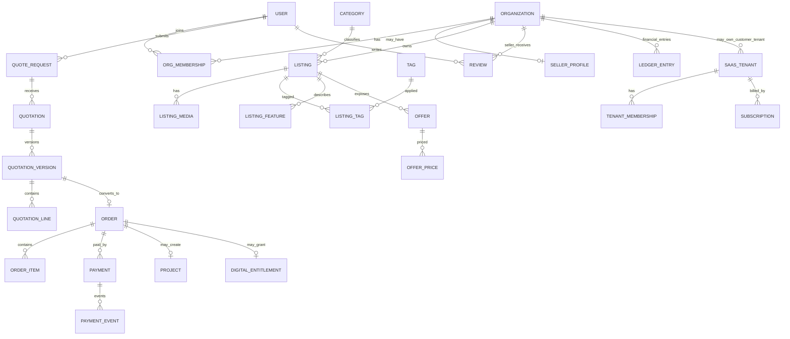

# Data Model — Website Marketplace

**Version:** 1.0-draft  
**Database:** PostgreSQL (recommended)  
**Convention:** UUID primary keys, UTC timestamps, soft archive where history matters

> **Runtime data model extension:** `MULTI_TENANT_TEMPLATE_ARCHITECTURE.md` mô tả chi tiết các entity `tenants`, `sites`, `site_domains`, template/module versions, assignments, page revisions và deployment. Khi triển khai, hợp nhất hai model marketplace và runtime theo đúng ranh giới: Organization/Seller thuộc Marketplace; Tenant/Site thuộc Website Runtime. Không dùng chung `organization_id` để thay `tenant_id`.

## 1. Modeling Principles

1. `Listing` mô tả giải pháp được trưng bày; `Offer` mô tả lựa chọn thương mại có thể mua/đặt/thuê.
2. Một listing có thể có nhiều offer; offer có một `fulfillment_type` và một `pricing_model` hợp lệ.
3. Platform và partner đều là `Organization`; platform listing thuộc organization kiểu `PLATFORM`.
4. Customer workspace và seller workspace là organization; SaaS runtime tenant là entity riêng.
5. Order/quotation lưu snapshot dữ liệu thương mại tại thời điểm giao dịch; không phụ thuộc listing/offer hiện tại.
6. Tiền lưu bằng integer minor units và currency code; tuyệt đối không dùng float/double cho phép tính tiền.
7. Dùng FK/unique/check constraints cho các invariants có thể đảm bảo ở DB; domain rules vẫn cần service validation.
8. Dùng JSONB cho câu trả lời form mở rộng/metadata không ổn định; không dùng JSONB để thay thế quan hệ cốt lõi hoặc bộ lọc catalog thường xuyên.
9. Record tài chính/audit không hard-delete. Dùng status, reversal/adjustment hoặc anonymization theo policy.
10. Mọi bảng tenant-scoped phải có tenant boundary rõ và truy vấn luôn mang context.

## 2. ER Diagram (Logical)



## 3. Enumerations

```text
organization_type:
  PLATFORM | SELLER | CUSTOMER

organization_status:
  ACTIVE | PENDING | SUSPENDED | CLOSED

seller_status:
  DRAFT | APPLIED | UNDER_REVIEW | APPROVED | REJECTED | SUSPENDED

listing_status:
  DRAFT | SUBMITTED | IN_REVIEW | CHANGES_REQUESTED | REJECTED | PUBLISHED | SUSPENDED | ARCHIVED

listing_kind:
  WEBSITE_TEMPLATE | BUSINESS_WEBSITE | LANDING_PAGE | ECOMMERCE | WEB_APPLICATION | SAAS_PRODUCT | CUSTOM_SERVICE | OTHER

fulfillment_type:
  SOURCE_CODE | MANAGED_SERVICE | SAAS | CUSTOM_PROJECT

pricing_model:
  FIXED | STARTING_AT | QUOTE | SUBSCRIPTION

billing_interval:
  ONE_TIME | WEEK | MONTH | YEAR

offer_status:
  DRAFT | ACTIVE | INACTIVE | ARCHIVED

request_status:
  NEW | TRIAGED | IN_REVIEW | WAITING_CUSTOMER | QUOTATION_SENT | CONVERTED | CLOSED_WON | CLOSED_LOST | SPAM

quotation_status:
  DRAFT | SENT | ACCEPTED | REJECTED | EXPIRED | SUPERSEDED | CANCELED

order_status:
  PENDING_PAYMENT | CONFIRMED | CANCELLED | REFUND_PENDING | PARTIALLY_REFUNDED | REFUNDED | COMPLETED

project_status:
  NOT_STARTED | KICKOFF | IN_PROGRESS | IN_REVIEW | DELIVERED | ACCEPTED | ON_HOLD | CANCELLED

payment_status:
  REQUIRES_ACTION | PENDING | SUCCEEDED | FAILED | CANCELLED | PARTIALLY_REFUNDED | REFUNDED

subscription_status:
  INCOMPLETE | TRIALING | ACTIVE | PAST_DUE | CANCEL_AT_PERIOD_END | CANCELED | SUSPENDED

tenant_status:
  REQUESTED | PROVISIONING | ACTIVE | GRACE_PERIOD | SUSPENDED | CANCELED | ARCHIVED

review_status:
  PENDING | PUBLISHED | HIDDEN | REJECTED
```

Status enum migration should be treated carefully; for flexible future workflows, DB text + check constraint or lookup table may be preferable to native enum depending on migration practices.

## 4. Core Identity and Organization Tables

### 4.1 `users`

| Column | Type | Rules |
|---|---|---|
| id | uuid | PK |
| email | citext/varchar | unique, normalized, verified separately |
| password_hash | text nullable | nullable for social/SSO-only accounts |
| full_name | varchar(160) | required |
| phone | varchar(32) nullable | normalized where possible |
| avatar_asset_id | uuid nullable | FK media_assets |
| email_verified_at | timestamptz nullable |  |
| status | varchar | ACTIVE / INVITED / LOCKED / DEACTIVATED |
| last_login_at | timestamptz nullable |  |
| created_at, updated_at | timestamptz | required |
| deleted_at | timestamptz nullable | soft delete/anonymization workflow |

Indexes: unique lower(email) if citext is not used; `(status, created_at)`.

### 4.2 `organizations`

Represents platform, seller, or customer workspace.

| Column | Type | Rules |
|---|---|---|
| id | uuid | PK |
| type | organization_type | required |
| name | varchar(200) | required |
| slug | varchar(180) | unique |
| legal_name | varchar(250) nullable |  |
| tax_identifier | varchar(80) nullable | access restricted |
| country_code | char(2) | default VN initially |
| default_currency | char(3) | default VND |
| status | organization_status | required |
| created_at, updated_at | timestamptz | required |

Seed one `PLATFORM` organization. Do not use a sellerId constant hardcoded in application code.

### 4.3 `organization_memberships`

| Column | Type | Rules |
|---|---|---|
| id | uuid | PK |
| organization_id | uuid | FK organizations |
| user_id | uuid | FK users |
| role_code | varchar(60) | org-scoped role |
| status | varchar(24) | INVITED / ACTIVE / REVOKED |
| joined_at | timestamptz nullable |  |
| created_at, updated_at | timestamptz |  |

Unique `(organization_id, user_id)`. Index `(user_id, status)` and `(organization_id, role_code, status)`.

### 4.4 `seller_profiles`

| Column | Type | Rules |
|---|---|---|
| id | uuid | PK |
| organization_id | uuid | unique FK organizations where type=SELLER or PLATFORM |
| seller_type | varchar(24) | PLATFORM / PARTNER |
| status | seller_status | required |
| public_name | varchar(200) | required |
| description | text nullable | sanitized rich text |
| logo_asset_id | uuid nullable | FK media_assets |
| website_url | text nullable | validate scheme/host; no server-side fetch |
| support_email | citext nullable |  |
| support_policy | text nullable |  |
| approved_at | timestamptz nullable |  |
| approved_by | uuid nullable | FK users |
| created_at, updated_at | timestamptz |  |

### 4.5 `seller_applications`

Stores partner onboarding and review.

Fields: `id`, `organization_id`, `submitted_by_user_id`, `business_type`, `portfolio_url`, `contact_snapshot JSONB`, `verification_data JSONB` (restricted), `status`, `reviewer_user_id`, `review_note_private`, `submitted_at`, `reviewed_at`, timestamps.

Do not store identity documents in general JSON. Store in private object storage with metadata, access controls and retention rules.

## 5. Catalog Tables

### 5.1 `categories`

Fields: `id`, `parent_id nullable`, `name`, `slug`, `description`, `icon_key`, `sort_order`, `status`, `seo_title`, `seo_description`, timestamps.

Constraints: unique `(parent_id, slug)` or globally unique slug depending URL strategy; prevent parent cycles in service. Use adjacency list for first version; closure table only if deep taxonomy operations require it.

### 5.2 `tags`

Fields: `id`, `name`, `slug`, `tag_group`, `status`, timestamps. Unique slug.

### 5.3 `listings`

| Column | Type | Rules |
|---|---|---|
| id | uuid | PK |
| owner_organization_id | uuid | FK organizations |
| category_id | uuid | FK categories |
| slug | varchar(220) | public unique slug |
| title | varchar(220) | required |
| short_description | varchar(500) | required |
| description | text | sanitized rich text |
| listing_kind | listing_kind | required |
| status | listing_status | required |
| featured | boolean | default false; admin controlled |
| demo_url | text nullable | validated; treat as untrusted external link |
| preview_mode | varchar(24) | EXTERNAL_LINK / APPROVED_EMBED / SCREENSHOTS |
| primary_media_asset_id | uuid nullable | FK media_assets |
| seo_title | varchar(220) nullable |  |
| seo_description | varchar(320) nullable |  |
| published_at | timestamptz nullable |  |
| moderation_note_private | text nullable | never in public DTO |
| created_by_user_id | uuid | FK users |
| updated_by_user_id | uuid | FK users |
| created_at, updated_at | timestamptz |  |
| archived_at | timestamptz nullable |  |

Indexes: unique `(slug)`; `(status, published_at DESC)`; `(category_id, status)`; `(owner_organization_id, status)`; full-text index over title/summary/description as required.

### 5.4 `listing_revisions`

Fields: `id`, `listing_id`, `revision_number`, `snapshot JSONB`, `submitted_by_user_id`, `moderation_status`, `reviewed_by_user_id`, `reviewed_at`, `change_summary`, `created_at`.

Unique `(listing_id, revision_number)`. Snapshot must represent content submitted for review, not a mutable reference.

### 5.5 `listing_media`

Fields: `id`, `listing_id`, `asset_id`, `media_type`, `alt_text`, `sort_order`, `created_at`. Unique `(listing_id, asset_id)`.

### 5.6 `listing_tags`

Fields: `listing_id`, `tag_id`; composite PK.

### 5.7 `feature_definitions` and `listing_features`

`feature_definitions`: `id`, `key`, `label`, `data_type`, `group_name`, `filterable`, `displayable`, `status`.

`listing_features`: `id`, `listing_id`, `feature_definition_id`, `value_text`, `value_boolean`, `value_number`, `value_json`, `created_at`.

Use typed value columns or a normalized `value_json` with validator; define one canonical value per data type. Do not allow arbitrary feature keys from seller input to create unbounded DB columns. For public filters, only use reviewed definitions marked `filterable`.

## 6. Offers and Pricing

### 6.1 `offers`

| Column | Type | Rules |
|---|---|---|
| id | uuid | PK |
| listing_id | uuid | FK listings |
| code | varchar(80) | unique within listing |
| name | varchar(180) | e.g. Basic / Professional / Annual |
| description | text nullable |  |
| fulfillment_type | fulfillment_type | required |
| pricing_model | pricing_model | required |
| status | offer_status | required |
| requires_consultation | boolean | default false |
| license_summary | text nullable | source offers |
| delivery_scope JSONB | jsonb | structured includes/excludes/deliverables |
| support_policy JSONB | jsonb nullable | response hours/period; validated schema |
| billing_interval | billing_interval nullable | required for recurring subscription offer |
| trial_days | integer nullable | only SaaS subscription where allowed |
| max_quantity | integer nullable |  |
| sort_order | integer |  |
| created_at, updated_at | timestamptz |  |
| archived_at | timestamptz nullable |  |

Validation examples:
- `pricing_model=SUBSCRIPTION` requires `fulfillment_type=SAAS`, `billing_interval` in WEEK/MONTH/YEAR and price record.
- `pricing_model=QUOTE` does not expose a payable amount; can optionally have a display `starting_from` only if clearly not a final quote.
- `fulfillment_type=SOURCE_CODE` requires license/usage terms before publish.

### 6.2 `offer_prices`

Versioned price history.

Fields: `id`, `offer_id`, `currency`, `amount_minor`, `billing_interval`, `effective_from`, `effective_to nullable`, `is_active`, `created_by_user_id`, `created_at`.

Rules:
- At most one current active price for each `(offer_id, currency, billing_interval)` at a time.
- `amount_minor >= 0`; currency format validated.
- Never update a price record referenced by an order; insert a new price version.
- For `STARTING_AT`, label as estimate/from-price, not guaranteed final price.

### 6.3 `offer_assets`

Maps offer to deliverable source package or SaaS package metadata.
Fields: `id`, `offer_id`, `asset_id`, `asset_role`, `version_label`, `checksum_sha256`, `created_at`.
Access to assets is private; publish metadata only, not object URL.

## 7. Request and Communication Tables

### 7.1 `quote_requests`

| Column | Type | Rules |
|---|---|---|
| id | uuid | PK |
| reference_code | varchar(32) | unique, non-sequential/unpredictable enough |
| requester_user_id | uuid nullable | FK users; guest allowed |
| customer_organization_id | uuid nullable | FK organizations |
| related_listing_id | uuid nullable | FK listings |
| related_offer_id | uuid nullable | FK offers |
| title | varchar(220) | required |
| industry_category_id | uuid nullable | FK categories or project taxonomy |
| solution_type | varchar(60) | selected canonical code |
| goal | text | required |
| budget_min_minor | bigint nullable | currency-aware |
| budget_max_minor | bigint nullable | currency-aware |
| budget_currency | char(3) | default VND |
| target_date | date nullable | desired date, not guaranteed deadline |
| status | request_status | required |
| priority | varchar(16) | LOW / NORMAL / HIGH / URGENT |
| assigned_to_user_id | uuid nullable | staff assignment |
| contact_snapshot | jsonb | name/email/phone at submit; restricted |
| requirements_snapshot | jsonb | answers; schema version recorded |
| consent_version | varchar(32) | policy version |
| submitted_at | timestamptz | required |
| created_at, updated_at | timestamptz |  |

Indexes: unique reference; `(status, created_at DESC)`; `(assigned_to_user_id, status)`; `(requester_user_id, created_at DESC)`; `(related_listing_id, created_at DESC)`.

### 7.2 `request_attachments`

Fields: `id`, `quote_request_id`, `asset_id`, `uploaded_by_user_id nullable`, `scan_status`, `created_at`. Attachments use private storage.

### 7.3 `request_messages`

Fields: `id`, `quote_request_id`, `sender_user_id nullable`, `sender_type` (CUSTOMER/STAFF/SELLER/SYSTEM), `visibility` (CUSTOMER_VISIBLE/INTERNAL), `message_body`, `created_at`.

Customer-facing APIs must explicitly filter `visibility=CUSTOMER_VISIBLE`. Avoid returning the entity with an internal note property set to null; use separate DTOs.

### 7.4 `request_activities`

Fields: `id`, `quote_request_id`, `actor_user_id nullable`, `activity_type`, `from_status nullable`, `to_status nullable`, `summary`, `metadata JSONB`, `created_at`.

Activity timeline is append-only. Sensitive payload should be minimized.

## 8. Quotation Tables

### 8.1 `quotations`

Fields: `id`, `quote_request_id`, `seller_organization_id`, `customer_organization_id nullable`, `created_by_user_id`, `current_version_number`, `status`, `created_at`, `updated_at`.

### 8.2 `quotation_versions`

| Column | Type | Rules |
|---|---|---|
| id | uuid | PK |
| quotation_id | uuid | FK quotations |
| version_number | integer | unique per quotation |
| status | quotation_status | required |
| currency | char(3) | required |
| subtotal_minor | bigint | calculated server-side |
| discount_minor | bigint | >=0 |
| tax_minor | bigint | calculated server-side/policy |
| total_minor | bigint | calculated server-side |
| scope_snapshot | jsonb | included/excluded/deliverables |
| terms_snapshot | jsonb | payment, support, license, warranty |
| valid_until | timestamptz nullable | required for SENT in most cases |
| sent_at | timestamptz nullable |  |
| accepted_at | timestamptz nullable |  |
| accepted_by_user_id | uuid nullable |  |
| rejected_at | timestamptz nullable |  |
| rejection_reason | text nullable |  |
| created_at | timestamptz |  |

Unique `(quotation_id, version_number)`. Accepted version is immutable.

### 8.3 `quotation_lines`

Fields: `id`, `quotation_version_id`, `line_type`, `description`, `quantity`, `unit`, `unit_price_minor`, `discount_minor`, `tax_code`, `tax_rate_snapshot`, `line_total_minor`, `sort_order`, `metadata JSONB`.

Store a full immutable description so deleting/changing offer does not alter a historical quotation.

## 9. Commerce Tables

### 9.1 `orders`

| Column | Type | Rules |
|---|---|---|
| id | uuid | PK |
| order_number | varchar(40) | unique public reference |
| customer_organization_id | uuid nullable | FK organizations |
| customer_user_id | uuid nullable | FK users; guest checkout policy |
| source_quotation_version_id | uuid nullable | unique FK quotation_versions |
| status | order_status | required |
| currency | char(3) | required |
| subtotal_minor | bigint | immutable snapshot |
| discount_minor | bigint | immutable snapshot |
| tax_minor | bigint | immutable snapshot |
| total_minor | bigint | immutable snapshot |
| billing_snapshot | jsonb | name/address/tax info at purchase |
| terms_accepted_at | timestamptz nullable |  |
| terms_version | varchar(32) nullable |  |
| confirmed_at | timestamptz nullable |  |
| created_at, updated_at | timestamptz |  |

Constraint: `source_quotation_version_id` unique if not null; idempotency keys also unique scoped by actor/endpoint.

### 9.2 `order_items`

Fields: `id`, `order_id`, `listing_id nullable`, `offer_id nullable`, `seller_organization_id`, `listing_snapshot JSONB`, `offer_snapshot JSONB`, `fulfillment_type`, `quantity`, `unit_price_minor`, `discount_minor`, `tax_minor`, `line_total_minor`, `currency`, `created_at`.

The snapshot should include listing title, offer name, fulfillment type, pricing terms, license, scope, seller display name and relevant offer configuration at purchase time.

### 9.3 `checkout_sessions`

Fields: `id`, `customer_user_id nullable`, `customer_organization_id nullable`, `status`, `currency`, `cart_snapshot JSONB`, `expires_at`, `idempotency_key`, `created_at`, `updated_at`.

If cart is not in MVP, use checkout session for a single offer/order intent; avoid building an extensible cart until multi-item checkout is needed.

### 9.4 `payments`

Fields: `id`, `order_id nullable`, `subscription_id nullable`, `provider_code`, `provider_payment_id nullable`, `merchant_reference`, `amount_minor`, `currency`, `status`, `payment_method_type`, `paid_at nullable`, `failure_code nullable`, `failure_message_safe nullable`, `created_at`, `updated_at`.

A payment belongs to an order or subscription invoice; enforce exactly one association using check constraint.

### 9.5 `payment_events`

Fields: `id`, `provider_code`, `provider_event_id`, `event_type`, `signature_verified`, `payload_redacted JSONB`, `processing_status`, `received_at`, `processed_at nullable`, `error_code nullable`.

Unique `(provider_code, provider_event_id)`. Avoid storing raw secrets/card data; encrypt/redact provider payload as appropriate.

### 9.6 `refunds`

Fields: `id`, `payment_id`, `amount_minor`, `currency`, `reason_code`, `reason_text`, `status`, `provider_refund_id nullable`, `requested_by_user_id`, `approved_by_user_id nullable`, `processed_at nullable`, timestamps.

### 9.7 `idempotency_records`

Fields: `id`, `scope`, `idempotency_key`, `actor_id nullable`, `request_hash`, `response_status`, `response_body JSONB`, `resource_id nullable`, `expires_at`, `created_at`.

Unique `(scope, idempotency_key, actor_id)` with careful NULL semantics; use normalized actor key or partial indexes if anonymous calls are supported.

## 10. Delivery and Project Tables

### 10.1 `digital_entitlements`

Fields: `id`, `order_item_id`, `customer_user_id`, `asset_id`, `license_code`, `license_snapshot JSONB`, `status` (ACTIVE/REVOKED/EXPIRED), `granted_at`, `revoked_at nullable`, `revocation_reason nullable`.

Unique key should prevent duplicate entitlement for same order item + asset + recipient.

### 10.2 `download_events`

Fields: `id`, `entitlement_id`, `user_id`, `asset_id`, `downloaded_at`, `ip_hash nullable`, `user_agent_summary nullable`, `result`.

Do not store full IP indefinitely unless there is a defined security requirement and retention policy.

### 10.3 `projects`

Fields: `id`, `order_id` unique, `customer_organization_id nullable`, `delivery_organization_id`, `project_number`, `title`, `scope_snapshot JSONB`, `status`, `project_owner_user_id`, `start_date`, `target_date`, `completed_at`, timestamps.

### 10.4 `project_milestones`

Fields: `id`, `project_id`, `name`, `description`, `sequence`, `status`, `due_at`, `completed_at`, `acceptance_required`, timestamps.

### 10.5 `project_deliverables`

Fields: `id`, `project_id`, `milestone_id nullable`, `asset_id`, `name`, `version_label`, `visibility`, `uploaded_by_user_id`, `created_at`.

### 10.6 `project_acceptances`

Fields: `id`, `project_id`, `milestone_id nullable`, `acceptance_type` (ACCEPTED/CHANGE_REQUESTED/REJECTED), `actor_user_id`, `comment`, `created_at`.

Acceptance should reference the version/deliverable or milestone under review; avoid ambiguous global “approved” flags.

## 11. Subscription and SaaS Tenant Tables

### 11.1 `plans`

Fields: `id`, `offer_id`, `code`, `name`, `entitlements JSONB`, `limits JSONB`, `is_active`, timestamps.

Plan terms should be versioned or snapshotted into subscription at activation.

### 11.2 `subscriptions`

Fields: `id`, `customer_organization_id`, `offer_id`, `plan_id`, `provider_code`, `provider_subscription_id nullable`, `status`, `currency`, `current_price_minor`, `billing_interval`, `trial_ends_at`, `current_period_start`, `current_period_end`, `cancel_at_period_end`, `canceled_at`, `created_at`, `updated_at`.

### 11.3 `saas_tenants`

Fields: `id`, `customer_organization_id`, `subscription_id nullable`, `product_code`, `tenant_key`, `display_name`, `status`, `region`, `provisioning_reference`, `activated_at`, `suspended_at`, `archived_at`, timestamps.

Unique tenant_key scoped as product requires. This is a runtime customer workspace, not a seller account.

### 11.4 `tenant_memberships`

Fields: `id`, `tenant_id`, `user_id`, `role_code`, `status`, timestamps. Unique `(tenant_id, user_id)`.

### 11.5 `tenant_domains`

Fields: `id`, `tenant_id`, `hostname`, `verification_status`, `is_primary`, `verified_at`, timestamps. Unique hostname globally after verification; enforce domain ownership verification.

### 11.6 `tenant_usage_events`

Fields: `id`, `tenant_id`, `metric_code`, `quantity`, `occurred_at`, `source_event_key`, `metadata JSONB`.

Use deduplication key. Aggregate usage by billing period for enforcement and invoices.

### 11.7 `provisioning_jobs`

Fields: `id`, `tenant_id`, `idempotency_key`, `status`, `attempt_count`, `last_error_code`, `started_at`, `completed_at`, `next_retry_at`, timestamps.

Unique idempotency key. Store safe error code, not credentials or secret outputs.

## 12. Seller Finance and Reviews

### 12.1 `ledger_entries` (Phase 4)

Fields: `id`, `seller_organization_id`, `order_id nullable`, `payment_id nullable`, `entry_type`, `direction` (CREDIT/DEBIT), `amount_minor`, `currency`, `effective_at`, `reference_type`, `reference_id`, `reversal_of_entry_id nullable`, `created_at`.

Entries are append-only. Corrections use compensating entries; no update/delete of posted ledger rows. Define double-entry model and account chart before automated payout.

### 12.2 `payouts` (Phase 4)

Fields: `id`, `seller_organization_id`, `payout_reference`, `currency`, `amount_minor`, `status`, `provider_transfer_id nullable`, `requested_at`, `approved_at`, `paid_at`, `failure_reason_safe`.

### 12.3 `reviews`

Fields: `id`, `order_item_id`, `listing_id`, `seller_organization_id`, `customer_user_id`, `rating`, `title`, `body`, `status`, `moderation_reason`, `published_at`, timestamps.

Unique review per eligible order item/customer. Rating constraints (e.g. 1–5) and eligibility check in service.

## 13. Platform Infrastructure Tables

### 13.1 `media_assets`

Fields: `id`, `owner_organization_id nullable`, `uploaded_by_user_id nullable`, `storage_provider`, `bucket`, `object_key`, `original_filename`, `mime_type_detected`, `size_bytes`, `checksum_sha256`, `visibility` (PUBLIC/PRIVATE), `scan_status`, `status`, `created_at`, `deleted_at nullable`.

Do not store full signed URLs. Generate on demand.

### 13.2 `notifications`

Fields: `id`, `recipient_user_id nullable`, `recipient_email_snapshot nullable`, `channel`, `template_code`, `subject`, `payload_redacted JSONB`, `status`, `provider_message_id`, `attempt_count`, `sent_at`, `last_error_code`, timestamps.

### 13.3 `outbox_events`

Fields: `id`, `aggregate_type`, `aggregate_id`, `event_type`, `schema_version`, `payload JSONB`, `occurred_at`, `published_at nullable`, `attempt_count`, `last_error_code`.

### 13.4 `audit_logs`

Fields: `id`, `actor_user_id nullable`, `actor_type`, `action`, `resource_type`, `resource_id`, `organization_id nullable`, `ip_hash nullable`, `user_agent_summary nullable`, `before_summary JSONB nullable`, `after_summary JSONB nullable`, `reason nullable`, `correlation_id`, `created_at`.

Avoid complete sensitive document/payment payload in before/after snapshots.

### 13.5 `role_permissions` and `role_assignments`

Use a permission catalog (`permission_code`, description), role-permission mapping and assignment at platform or organization scope. Simpler implementations may begin with fixed role codes, but avoid hardcoding scattered `if (role === 'ADMIN')` checks throughout controllers.

## 14. Relationship and Constraint Checklist

- Listing owner must be active organization of type PLATFORM or SELLER.
- Listing category must be active for public publication.
- Listing slug unique globally or within locale/market as decided.
- Offer must belong to its listing; related listing and offer in a request must match.
- Offer price currency must match order/checkout currency unless FX conversion policy exists.
- Quotation line calculations and header totals must reconcile exactly.
- `source_quotation_version_id` unique on orders.
- Payment must associate exactly one order or subscription invoice.
- Provider event unique; idempotency key unique by scope.
- Download entitlement must belong to a paid/confirmed eligible order item.
- Review requires eligible fulfilled order item and unique customer review.
- SaaS tenant membership must be unique per user and tenant.
- Tenant domain must be verified before routing customer traffic.
- Ledger entries append-only and balanced according to chosen ledger model.

## 15. Indexing and Retention

### Initial indexes

- Users: normalized unique email.
- Listings: `(status, published_at DESC)`, `(category_id, status)`, `(owner_organization_id, status)`, unique slug.
- Offers: `(listing_id, status)`, `(fulfillment_type, pricing_model, status)`.
- Requests: `(status, created_at DESC)`, `(assigned_to_user_id, status)`, unique reference code.
- Quotations: `(quote_request_id, created_at DESC)`; unique `(quotation_id, version_number)`.
- Orders: unique order number, `(customer_organization_id, created_at DESC)`, `(status, created_at DESC)`.
- Payments: `(order_id, status)`, unique provider payment ID where present.
- Payment events: unique provider event ID.
- Notifications/outbox: `(status, created_at)` and retry indexes.
- Audit: `(resource_type, resource_id, created_at DESC)` and `(actor_user_id, created_at DESC)`.

### Retention principles

- Define explicit retention for request attachments, audit metadata, email logs, download logs and failed webhook payloads.
- Financial/order records follow legal/accounting retention rules confirmed by the business/legal team.
- User deletion should anonymize or detach personal identifiers where possible while preserving required financial/audit history.
- Do not purge seller/offer snapshots from historical orders.

---

**End of Data Model**
